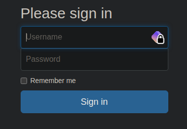

# Máquina Crocodile

#### OS: Linux
#### Tier: Starting Point
#### Released on: 6/10/2021
#### IP de ejemplo: 10.129.111.71

## Reconocimiento
comenzamos realizando un escaneo de puertos por tcp con `nmap`:
```
sudo nmap -sS -p- --open --min-rate 5000 -vvv -Pn -n 10.129.111.71
```
```
PORT   STATE SERVICE REASON
21/tcp open  ftp     syn-ack ttl 63
80/tcp open  http    syn-ack ttl 63
```
dos puertos: 21 (FTP) y 80 (HTTP). Vamos a escanear los puertos usando los scripts básicos de nmap y determinemos la versión para cada uno (-sCV)
```
nmap -sCV -p21,80 10.129.111.71
```
```
PORT   STATE SERVICE VERSION
21/tcp open  ftp     vsftpd 3.0.3
| ftp-anon: Anonymous FTP login allowed (FTP code 230)
| -rw-r--r--    1 ftp      ftp            33 Jun 08  2021 allowed.userlist
|_-rw-r--r--    1 ftp      ftp            62 Apr 20  2021 allowed.userlist.passwd
| ftp-syst: 
|   STAT: 
| FTP server status:
|      Connected to ::ffff:10.10.14.223
|      Logged in as ftp
|      TYPE: ASCII
|      No session bandwidth limit
|      Session timeout in seconds is 300
|      Control connection is plain text
|      Data connections will be plain text
|      At session startup, client count was 3
|      vsFTPd 3.0.3 - secure, fast, stable
|_End of status
80/tcp open  http    Apache httpd 2.4.41 ((Ubuntu))
|_http-title: Smash - Bootstrap Business Template
|_http-server-header: Apache/2.4.41 (Ubuntu)
Service Info: OS: Unix
```
vemos que el ftp anónimo está habilitado, y parece que hay listas de usuarios. Vamos a entrar y a extraerlos
```
❯ ftp 10.129.111.71
Connected to 10.129.111.71.
220 (vsFTPd 3.0.3)
Name (10.129.111.71:w1s4): anonymous
230 Login successful.
```
traemos ambos archivos con `get <archivo>`, salimos de ftp con `exit` y leemos ambos archivos 
```
❯ cat allowed.userlist
───────┬───────────────────────────────────────────────────────────────────────────────────────────────────────────────────────────────────────────────────────────────────────────────────────────────────────────
       │ File: allowed.userlist
───────┼───────────────────────────────────────────────────────────────────────────────────────────────────────────────────────────────────────────────────────────────────────────────────────────────────────────
   1   │ aron
   2   │ pwnmeow
   3   │ egotisticalsw
   4   │ admin
───────┴───────────────────────────────────────────────────────────────────────────────────────────────────────────────────────────────────────────────────────────────────────────────────────────────────────────
❯ cat allowed.userlist.passwd
───────┬───────────────────────────────────────────────────────────────────────────────────────────────────────────────────────────────────────────────────────────────────────────────────────────────────────────
       │ File: allowed.userlist.passwd
───────┼───────────────────────────────────────────────────────────────────────────────────────────────────────────────────────────────────────────────────────────────────────────────────────────────────────────
   1   │ root
   2   │ Supersecretpassword1
   3   │ @BaASD&9032123sADS
   4   │ rKXM59ESxesUFHAd
───────┴─────────────────────────────────────────────────────────────────────────────────────────────────────────────────────────────────────────────────────────────────────────────────────────────────────────
```
tenemos una lista de usuarios y contraseñas. Suponiendo que el formato es user1:pass1 | user2:pass2 ETC, quedaría esta lista, que llamamos credentials.txt
```
───────┬─────────────────────────────────────────────────────────────────────────────────────────────────
       │ File: credentials.txt
───────┼─────────────────────────────────────────────────────────────────────────────────────────────────
   1   │ aron:root
   2   │ pwnmeow:Supersecretpassword1
   3   │ egotisticalsw:@BaASD&9032123sADS
   4   │ admin:rKXM59ESxesUFHAd
───────┴─────────────────────────────────────────────────────────────────────────────────────────────────

```
esto en sí es un gran problema de seguridad: no solo están las contraseñas en un servidor FTP con anonymous login permitido sino que además las contraseñas están en texto claro. Esto hace que una contraseña compleja, como `@BaASD&9032123sADS` sea igual de fuerte en la práctica que la contraseña `root`. Para tener las contraseñas almacenadas de forma segura debería usar un algoritmo de hashing como `argon2`, con al menos 3 iteraciones. Esto hace que una contraseña en texto claro pase a verse como un hash así: 
```
$argon2id$v=19$m=262144,t=4,p=4$c21hbGxzYWx0$y0RH2R3WKwhaVV4T68xvBPTGZjiGBrLEAd34AwVfVKw
```
si bien se pueden crackear con herramientas como `Hashcat`, aquí una contraseña fuerte sí tiene sentido, pues los recursos para romper una contraseña compleja y que no aparece en diccionarios es simplemente inasumible.

Con esto en mente, vamos a investigar la página web


vemos una landing page normal, vamos a realizar fuzzing para descubrir rutas ocultas bajo esta web:
```
ffuf -c -ic -w /usr/share/seclists/Discovery/Web-Content/common.txt -u http://10.129.111.71/FUZZ
```
entre los resultados vemos /dashboard, con un redirect (code 301). 
```
dashboard               [Status: 301, Size: 318, Words: 20, Lines: 10, Duration: 81ms]
```
Vamos a ver qué hay



vemos un panel de login, nos ha redirigido a /login.php. Probemos las credenciales que obtuvimos del FTP, el usuario `admin` parece interesante, tratemos de loguearnos con ese usuario y su contraseña, `rKXM59ESxesUFHAd`. 

Entramos a un panel de administración, y vemos la flag en la parte superior
```
Here is your flag: <REDACTED>
```
